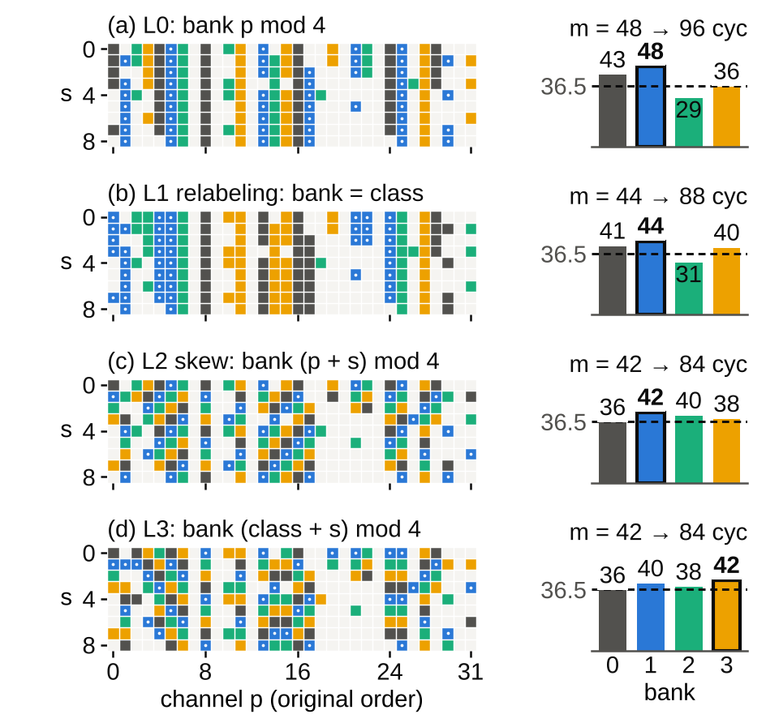
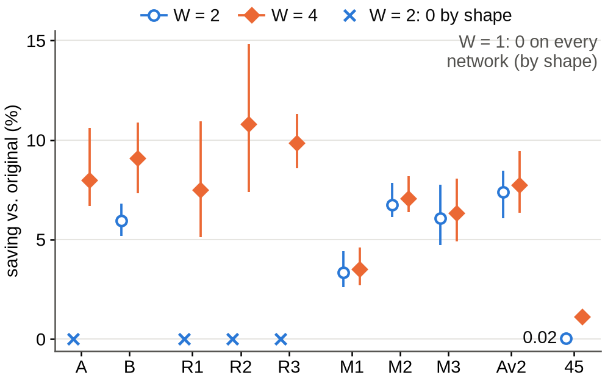
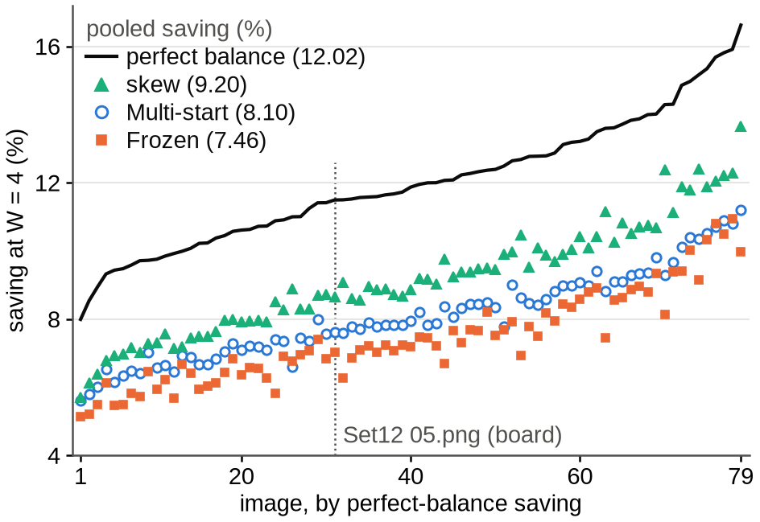

# Reducing Bank-Synchronization Cycles of a Zero-Skipping FPGA CNN Core by Offline Channel Permutation

(Author names), (Affiliation, e-mail)

> **Before submission** (the Word builder `iweict2026/build_docx.py` drops every `>` line; delete this box when it is done)
>
> 1. **Blocking: tap-level layouts.** The skew is a count (`skew_count.py`, 2928d28) with an oracle exactness check. Remaining: (a) export and driver path for skewed windows and permuted `config.bin` weight columns, a bit-exact FPGA check and its host time; (b) one board run of the skew on 05.png against its exact prediction; (c) the skew on the ten networks and 80 images; (d) a relabeling fitted on top of the skew, as a new hypothesis pushed before the fit, apart from H0–H3. Uncommitted review counts of (d) (7 images) and of the skew on 8 images of B and maxout s1 were seen: the new protocol must disclose them; the paper must not cite them. Then decide whether to rebuild the paper around static tap-to-bank layouts.
> 2. **Raw board reports.** Commit the ten `report.json` files, `canary.json`, `triplet_summary.json`, the XSDB logs and the SHA-256 of the PNGs and the `.bit` under `denoise/board_runs/`; regenerate Table I from them instead of `board_transcribed.json` and delete the "transcribed" marks (abstract, Sections IV, V-A, VI, Table I). If they cannot be recovered, rerun the triplet.
> 3. **More board images.** Commit exact predictions on a few more Set12 images, run each once at W = 4 and accept a layer only on an exact match.
> 4. **Board identity.** ZedBoard (`paper/03_method.md`) or Smart ZYNQ SL with a ZC702-preset design (notes of 2026-10-18): read the PCB and DDR markings and name the board in Section IV.
> 5. **Per-network headroom** in Fig. 2 (pooled perfect-balance saving and share per network), so that a weak fit (maxout s1) can be told from a small opportunity.
> 6. **Authors and venue.** The advisor's name, affiliation and e-mail are placeholders (`--author2`, `--affil2`, `--email2`). IEEE ESL: 4 pages with figures, tables and references. With `--col-fig-cm 8` this draft builds to four A4 pages of the IWEICT Word template in LibreOffice; the IEEE template and Word may lay it out differently. Check the abstract and reference limits.
> 7. **References.** Cut from 21 to 10 (`references.json` `paper_n`); Budnik and Kuck [7] was checked on metadata only: read it before submission.
> 8. **Commit and archive.** Commit `bankperm/figures/`; archive the repository (e.g. Zenodo DOI) for the code-and-data line. Decide the overlap with the IWEICT paper (`IWEICT_INSERT_EN.md`) and which layout leads (Frozen was pushed before the board run, Multi-start chosen after its BSD68 counts, the skew counted after the study).
> 9. **Numbering.** The former Table I (shape condition) is now text, the former Table II (board) is Table I with totals and conv2–9 sums only, the former Table III (baselines) is Table II with fewer rows; `README.md` maps the numbers.

## Abstract

A zero-skipping convolution core whose input banks run in lockstep waits, in every window, for the bank with the most nonzero activations. In our integer CNN core on a Zynq XC7Z020, where the channel count is a multiple of 4, the channel order decides which channels share a bank. We fix this order offline on calibration images and fold it into the adjacent layers, leaving the bitstream and integer output unchanged; the layer shapes show where this cannot pay. At four values per cycle, two relabelings of a 32-channel denoiser cut the core cycles measured on one image (transcribed from run notes) by 7.02% and 7.60%, which a model pushed before the export predicted to the cycle net of reported DMA stalls; under a protocol pushed before the fits, the pooled count fell on all ten networks. A data-free skewed tap layout, counted after the study, saves more: 9.20% pooled over 79 images against 7.46% and 8.10%.

**Keywords** — zero skipping, activation sparsity, load balancing, channel permutation, FPGA, CNN accelerator, cycle model

## I. Introduction

A core that skips zero activations saves multiplications, but lanes that advance together make each window cost as much as the busiest one, a stall Cnvlutin measures as its own category [1]. Known remedies for activation imbalance change the network or add hardware: S2TA bounds the nonzeros per block by discarding activations [2], and Sense rebalances channels at run time, noting that input maps "cannot be trained offline to balance IFM workload" [3]. Offline, function-preserving reorderings balance weights: SparTen sorts filters by density and reorders the next layer's weights to match [4], and Pool and Yu fold a channel permutation for N:M pruning into the preceding layer [5]. VARA permutes inputs offline from activation statistics but reads them through an index unit [6], and skewed storage gives conflict-free parallel access to the rows and columns of a matrix [7]. Permutation, folding, profiling and skewing are thus not new; our search (Crossref, arXiv, web; October 2026) found no work that spreads co-active channels over lockstep banks by an exact, folded relabeling.

In our core four tap banks run in lockstep, and in 32- and 64-channel layers all nine taps of a channel share the bank given by its index mod 4. A folded channel relabeling moves nonzeros between banks with the function exact, but balances them only on average, as activations change with the input. We give a shape-only condition for a layout to change a layer's cycles (Section II), a board measurement predicted to the cycle (Section V-A), and a ten-network study under a protocol pushed before the fits, with baselines, among them a data-free skew of the taps (Sections V-B, V-C). The contribution is empirical: how much of the bank-imbalance cost static layouts remove on unseen images, and cycle-exact prediction.

## II. Core, Cost Model and Bank Layout

**Core.** The host builds each layer's windows (im2col), sends them with the layer's weights and requantizes between layers; the core computes every convolution with INT8 weights, 7-bit unsigned activations and INT32 accumulation. Its 64 multipliers form P = 16 output lanes times T = 4 tap banks; its window port takes W values per cycle (W = 2 only in RTL simulation). In sparse mode, used throughout, each bank processes only its nonzero taps.

**Cost of a window.** For a window with K taps and COUT outputs, and m the largest number of nonzero taps in one bank, the core spends C cycles:

  C = max( ⌈K/W⌉ + 1, ⌈COUT/P⌉ · max(1, m), COUT ),   (1)

for loading the next window, computing ⌈COUT/P⌉ output groups and emitting COUT results. Each layer adds a fill and drain of min(load, compute of the last window) + 3 + g cycles, g being the outputs in the last group of P, a rule read off board runs of four networks; the first layer has a measured constant (17 cycles for the board network at W = 4). We call (1) summed over the windows the count, and the count plus the fill and drain the exact prediction.

**Bank of a tap.** In (ky, kx, channel) order, tap t = s·N + p (s the 3×3 position, p the channel, N the input channels) sits in bank t mod T, which is p mod 4 when 4 divides N: each bank holds N/4 whole channels (Fig. 1a), and a permutation of the channels decides which share a bank (Fig. 1b). As the host builds the windows, the taps can also be reordered together with the consumer's weight columns; no partial sum, in any order, exceeds |bias| + K·127·128 < 2³¹, so the INT32 result is unchanged. The data-free skew puts channel p of position s in slot s·N + (p + s) mod N, bank (p + s) mod 4, spreading each channel's nine taps 3/2/2/2 over the banks (Fig. 1c).

*Fig. 1. A conv5 input window of the board network on Set12 05.png (of the windows compute-bound at W = 4, the first in raster order with the median m of 48). Rows: positions s; columns: channels p; filled: nonzero, colored by bank (bank 1 dotted). (a) Bank p mod 4; (b) Frozen (16 of 32 channels change bank); (c) skew, bank (p + s) mod 4. Bars: nonzeros per bank; the fullest, m, costs 2m cycles; dashed: m = 36.5, where 2m equals the load of 73 cycles.*

**When a layout can pay.** A bank holds at most ⌈K/T⌉ taps. No window is then compute-bound for any input, and no layout can change the count, if

  ⌈COUT/P⌉ · ⌈K/T⌉ ≤ max( ⌈K/W⌉ + 1, COUT ).   (2)

Failing (2) is thus necessary for a gain; without the rounding, (2) reads COUT ≤ P·T/W, the ridge point of a roofline [8] whose bandwidth roof is the load. For K = 288 and COUT = 32, the left side is 144 against 145 at W = 2 and 73 at W = 4, so 32-output hidden layers can pay only at W = 4; layers with 45 or 64 outputs also at W = 2; no layer at W = 1 and no last layer (COUT ≤ 4). As a reference, perfect balance, m = ⌈n/T⌉ for n nonzero taps, bounds every assignment of a window's taps to lockstep banks.

## III. Function-Preserving Relabeling

**Folding.** Let π map a position p of a hidden map to its original channel. The producer computes its output channels in the order π, with weight rows, biases and requantization scales reordered, and the consumer's weight column for tap s·N + p comes from channel π(p). As ReLU and requantization act per channel and the consumer adds the same INT32 products, the integer output is identical for every input. We permute the outputs of conv1 to conv(L−2) of an L-layer network; the last layer, which can never pay, keeps its input. In the maxout and averaging networks, which keep the maximum or mean of maps j and j + N of 2N computed maps, both maps move with π. For N = 45, tap s·45 + p is in bank (s + p) mod 4: the conventional layout already has the skew's banks.

**Fitting.** Relabeled windows are original windows with permuted columns, so each layer is fitted alone. The recipe, Frozen, draws 2048 windows per fitted layer from Set12 01.png (Cal-1; σ = 25, one noise draw), minimizes their mean of (1) at W = 4, and searches from the identity with 400 proposals, each swapping two channels of different classes and kept only if the objective falls (7.1–28.8 s per network on a 4-core x86 server). A second layout of the board network, Multi-start, adds Set12 02–03, two noise draws per image (Cal-3) and four random starts (2005 objective evaluations per layer against 401); it was chosen for the board after its BSD68 counts had been seen.

## IV. Experimental Setup

**Networks and images.** Ten trained integer DnCNN-style networks [9] of six architectures, for Gaussian noise of σ = 25 on 7-bit inputs: A, 7 layers of 32 channels; B, 10 layers of 64 channels behind a 2×2 space-to-depth input; B-32, the same with 32 channels, with ReLU (training seeds s1–s3), maxout over pairs of 64 computed outputs (s1–s3) or their mean (s2); and a 45-channel ReLU variant. All but A had quantization-aware training. The board network, B-32 ReLU s1, reaches 29.54 dB on Set12 05.png; 37–55% of its hidden layers' window values are nonzero. Test images: Set12 [9] and BSD68 [10], 80 images, one noise draw each; savings exclude the calibration images unless stated.

**Board.** The W = 4 bitstream for the XC7Z020 closes timing at 100 MHz (worst negative slack +0.130 ns), uses 11,151 LUTs (21%), 71 of 140 BRAM36-equivalent tiles and no DSP slice, and ran at the board preset's 50 MHz. One bitstream ran all three layouts; per layer the driver checks the output against the integer model and reads the cycle counter CYCLES and the DMA-wait counter IN_STALL. On 05.png the Original ran once as a canary, then each layout three times in alternation. These board cycles are transcribed from run notes, each checked by a script against its cited line (an earlier run of the Original is a committed raw report). All other cycle numbers are counts over the windows of the host emulation, which reproduces every network's reference PSNR on all 80 images.

**What was fixed when** (GitHub push times, UTC). The fill-and-drain rule (6dc0e60, 10-17 13:15) preceded both exports but was read off board runs that include the board network's Original, whose layers are thus in sample; Frozen's per-layer count savings on 05.png (9cf9c79, 10-17 18:38) preceded the board runs; a protocol (c2299e2, 10-18 18:32) fixed the recipe, the evaluation, condition (2) per layer and four hypotheses before any fit on the other nine networks. The skew was counted after the results were written, outside that protocol (2928d28).

## V. Results

### A. Board Measurement

On Set12 05.png (Table I), Multi-start lowered the board total from 13,289,030 to 12,278,419 cycles (−7.60%) and Frozen to 12,355,814 (−7.02%). The repeats gave the same numbers, except 12 more cycles in Frozen's third run, all in conv10, where IN_STALL was also 12; none of the 90 layer runs had an output mismatch. In all 63 comparisons (every layer of Original and Multi-start, sums and totals of canary, repeats and the earlier run), CYCLES − IN_STALL equaled the exact prediction; as the repeats are deterministic and conv1 and conv10 see the same windows in every layout, nine are independent and out of sample, all on one image: Multi-start's conv2–conv9 and Frozen's conv2–9 sum. Relabeling lowered the fullest bank's mean nonzero count in every layer (conv9, Multi-start: 43.04 to 35.10); Multi-start removed 66.2% and Frozen 61.1% of the saving of perfect balance (11,761,449 cycles, −11.49%).

*Table I. Core cycles of B-32 ReLU s1 on Set12 05.png at W = 4. Board: repeat 1, transcribed from run notes, each equal to the exact prediction. Count: (1) summed, without fill and drain. Saving: board, conv2–9 / total.*

| Layout | Board, conv2–9 | Board, total | Count, total | Saving (%) |
|--------|-------|-------|-------|---------|
| Original | 11,421,202 | 13,289,030 | 13,288,456 | — |
| Frozen | 10,487,986 | 12,355,814 | 12,355,274 | 8.17/7.02 |
| Multi-start | 10,410,591 | 12,278,419 | 12,277,883 | 8.85/7.60 |

### B. Study of Ten Networks

The protocol fixed two checks and two sign predictions. H0: our code reproduced the earlier Frozen layout in all eight layers, and folding it reproduced the Frozen export byte for byte. H1: wherever (2) holds, at W = 1 on all networks and at W = 2 on A and B-32 ReLU s1–s3, the relabeled count equaled the original on all 80 images. H2: the pooled W = 4 saving over the 79 images was positive on all ten networks, 1.09–10.80% (Fig. 2; the sign was known for B, maxout s1 and the board network). H3: the pooled W = 2 saving was positive on all six networks where (2) allows it, 3.36–7.37% on five and 0.022% on the 45-channel network, where 16 of 632 image-layers (8 fitted layers × 79 images) got worse (at most 3 on any other network). No image counted more cycles on any network at any W.

*Fig. 2. Pooled saving of the recipe over the 79 images other than the calibration image (count, conv1–convL); lines: per-image range; ×: (2) holds in every layer, saving exactly 0. A: 7 × 32; B: 10 × 64; R1–R3, M1–M3: B-32 ReLU and maxout, seeds s1–s3 (R1: board network); Av2: averaging, s2; 45: 10 × 45 ReLU.*

In emulation every folded network reproduced the original's PNG bytes on Set12 05.png and BSD68 test001.png. Maxout s1 gained only 3.50% at W = 4; without per-network headroom, a weak fit cannot be told from a small opportunity. As the protocol's search routine rejects N = 45, that network was fitted with a general bank rule (identical layouts on the 69 layers where both apply).

### C. Eighty Images and Baselines

At W = 4 (Fig. 3), Frozen saved 5.13–10.94% per image on the 79 images other than its calibration image (pooled 7.46%), Multi-start 5.62–11.19% on the 77 other than its three (pooled 8.11%); perfect balance would save 7.99–16.62% (pooled 12.02%). One of Frozen's 632 fitted image-layers counted more (+1.56%), none of Multi-start's 616. From the smallest saving, 05.png ranks 34th (Frozen) and 32nd (Multi-start) of 80.

*Fig. 3. Per-image W = 4 saving of the board network (count, conv1–10) on the 79 images other than Set12 01.png, sorted by the perfect-balance bound; legend: pooled saving over these 79, which include Multi-start's calibration images Set12 02–03 (not marked). Counts, not board runs.*

*Table II. Layouts of B-32 ReLU s1 at W = 4 (count, 79 images; † 77). p.i.: uses the test image. Random: the best of 20 on these images. Share: (original − layout)/(original − perfect balance), cycles summed over the images.*

| Layout | Pooled (%) | Share (%) |
|----------------|-----|-----|
| Random, best of 20 | 1.73 | 14.4 |
| Density sort [4], Cal-1 | 3.69 | 30.7 |
| Sense-like sort [3] (p.i.) | 4.89 | 40.7 |
| Frozen (board), Cal-1 | 7.46 | 62.1 |
| Multi-start (board), Cal-3† | 8.11 | 67.4 |
| Greedy, equal budget, Cal-3† | 8.24 | 68.5 |
| Recipe fitted per image (p.i.) | 8.45 | 70.3 |
| Skew, data-free (post hoc) | 9.20 | 76.6 |
| Perfect balance (bound) | 12.02 | 100 |

Twenty random layouts with eight channels per class saved −5.43% to +1.73% pooled, so savings against the identity understate those against a random order. Six density layouts after SparTen [4] captured 21–33% of the perfect-balance saving (Table II: the best), a Sense-like sort by each channel's nonzero count in the test image 40.7%, the deployable fitted layouts 62–68.5%; this compares procedures and does not isolate co-activation. Multi-start's 0.63-point lead over Frozen on the 77 images (8.11% against 7.48%) comes from Frozen's seed (the lowest of five), five times the budget and Multi-start's data, not its restarts: with equal data and budget, plain greedy search (Table II: mean of five seeds) beat Multi-start on four of five seeds.

**Skew (counted after the study, not run on the board).** On the inputs of conv2–conv9 the skew saved 9.20% pooled over the 79 images (0 at W = 1 and 2, as (2) requires) against 7.46% and 8.10% for the relabelings, and fewer cycles than both on every image (Fig. 3; on the 77 without Multi-start's calibration images, 9.22% against 8.11%); on 05.png it saved 8.64%, and in the integer oracle (4096 windows per layer of 05.png) it left every output unchanged. In counts on this network, the relabeling is thus not the best static layout; whether a relabeling fitted on top of the skew adds to it is open and will be tested under a new pre-registration.

## VI. Limitations

- **Board evidence.** One network and one image were measured; the fill-and-drain constants come from runs of the same image; the raw reports behind the transcribed cycles are not yet committed. This bitstream's IN_STALL misses DMA starvation at window boundaries (fixed in later RTL): the exact match excludes only hidden stalls that differ between layouts, and the rule's holding in RTL simulation, which has no DMA, suggests its constants contain none.

- **Scope.** Only core cycles are reported; the JTAG harness dominates the run time (315.0 s of debugger sessions against 0.266 s of core time in an earlier run); host time, energy and FIFO-decoupled banks were not measured. The skew has no export, board run or ten-network count yet.

- **Statistics and selection.** Only σ = 25 with one noise draw per image; W = 2 results are counts; no confidence intervals. BSD68 was part of the networks' development, and Multi-start was chosen after its BSD68 counts were seen.

## VII. Conclusion

On a zero-skipping core with lockstep banks, the layer shapes tell where the tap-to-bank layout can matter, and a folded relabeling changed the measured cycles exactly as counted, with identical output. It lowered the pooled count on all ten networks, but a data-free skew, counted and not yet run, saved more on the board network. Scripts, layouts, per-image counts and the source of every number are in bankperm/ of https://github.com/qewr1234/FPGA.

## References

[1] J. Albericio, P. Judd, T. Hetherington, T. Aamodt, N. Enright Jerger, and A. Moshovos, "Cnvlutin: Ineffectual-neuron-free deep neural network computing," in *Proc. ACM/IEEE 43rd Annu. Int. Symp. Comput. Archit. (ISCA)*, 2016, pp. 1–13, doi: 10.1109/ISCA.2016.11.

[2] Z.-G. Liu, P. N. Whatmough, Y. Zhu, and M. Mattina, "S2TA: Exploiting structured sparsity for energy-efficient mobile CNN acceleration," in *Proc. IEEE Int. Symp. High-Perform. Comput. Archit. (HPCA)*, 2022, pp. 573–586, doi: 10.1109/HPCA53966.2022.00049.

[3] W. Sun, D. Liu, Z. Zou, W. Sun, S. Chen, and Y. Kang, "Sense: Model-hardware codesign for accelerating sparse CNNs on systolic arrays," *IEEE Trans. Very Large Scale Integr. (VLSI) Syst.*, vol. 31, no. 4, pp. 470–483, 2023, doi: 10.1109/TVLSI.2023.3241933.

[4] A. Gondimalla, N. Chesnut, M. Thottethodi, and T. N. Vijaykumar, "SparTen: A sparse tensor accelerator for convolutional neural networks," in *Proc. 52nd Annu. IEEE/ACM Int. Symp. Microarchit. (MICRO)*, 2019, pp. 151–165, doi: 10.1145/3352460.3358291.

[5] J. Pool and C. Yu, "Channel permutations for N:M sparsity," in *Proc. Adv. Neural Inf. Process. Syst. (NeurIPS)*, vol. 34, 2021, pp. 13316–13327.

[6] P. Dang, Y. He, and H. Li, "VARA: A voltage-aware ReRAM-based accelerator for energy-efficient computing," arXiv:2609.00421, 2026.

[7] P. Budnik and D. J. Kuck, "The organization and use of parallel memories," *IEEE Trans. Comput.*, vol. C-20, no. 12, pp. 1566–1569, 1971, doi: 10.1109/T-C.1971.223171.

[8] S. Williams, A. Waterman, and D. Patterson, "Roofline: An insightful visual performance model for multicore architectures," *Commun. ACM*, vol. 52, no. 4, pp. 65–76, 2009, doi: 10.1145/1498765.1498785.

[9] K. Zhang, W. Zuo, Y. Chen, D. Meng, and L. Zhang, "Beyond a Gaussian denoiser: Residual learning of deep CNN for image denoising," *IEEE Trans. Image Process.*, vol. 26, no. 7, pp. 3142–3155, 2017, doi: 10.1109/TIP.2017.2662206.

[10] S. Roth and M. J. Black, "Fields of experts," *Int. J. Comput. Vis.*, vol. 82, no. 2, pp. 205–229, 2009, doi: 10.1007/s11263-008-0197-6.
