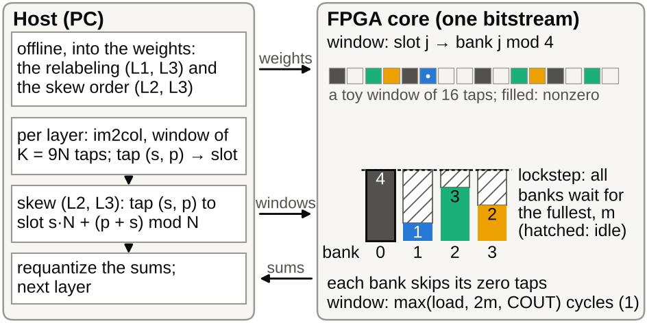

# Bank Layout Optimization for Zero-Skipping FPGA CNNs

(Author names), (Affiliation, e-mail)

> **Before submission** (the Word builder `iweict2026/build_docx.py` drops every `>` line; delete this box when it is done)
>
> 1. **Board runs done.** PROTOCOL_2's runs of L0, Frozen, Multi-start and L2 on Set12 05–08 (c18fc8f; `board_measured_2.json`, prediction `board_prediction_2.json`, 7312a84) and the addendum's L3 runs (1a327f7; `board_measured_3.json`, prediction `board_prediction_3.json`, 0887924, confirmed in 3cc95a6) are in V-A and Table I: 176/180 predicted layers exact, four conv8 layers +1 (the layers whose last window computes 30). The title and abstract must stay identical to `ABSTRACT_IWEICT.md` (changed together on 2026-10-19 evening: the author's new title, the board results). Space (2026-10-19 evening): page 4 of this LibreOffice build ends about 40 pt above the bottom margin in each column.
> 2. **Raw board reports.** Committed in 7ebb7ea (`denoise/board_runs/q1_layouts/`): every transcribed value of `board_transcribed.json` and the old Table I equals them, so the 'transcribed' marks are gone. They also hold triplet runs of L0, Frozen and Multi-start on Set12 04 and 06–12 that no earlier note mentioned. Over all 77 earlier runs, a check after the runs (scratch scripts, so not printed) gives 758/770 layers exact with conv1, 681/693 for conv2–conv10; the misses are the four conv8 layers with a last-window compute of 30. Their dates are not recorded; their board time puts them before the PROTOCOL_2 runs were pinned (07:24:27Z), 11 minutes after the prediction was written. The 05.png values gate `predict_board_2.py` (it must reproduce them before it writes). To do: ask the author when they ran; commit a check script if the paper is to print the 04–12 numbers.
> 3. **Independent verification** of `results_2.json`, `stats_2.json` and `host_time.json` finished (message of 0887924): no mismatch in `results_2.json`, `stats_2.json` or the verdicts. Its note is applied in V-D: `host_time.json`'s 6.82% uses the Original's host time for Multi-start too; with Multi-start's own (32.23 ms) the back-to-back bound is 6.27%, hence "6.3–6.8%".
> 4. **Board identity.** ZedBoard (`paper/03_method.md`) or Smart ZYNQ SL with a ZC702-preset design (notes of 2026-10-18): read the PCB and DDR markings and name the board in Sec. IV.
> 5. **Authors and venue.** The advisor, Gyu Sang Choi (marked * by the author), is in the submission copy; the repository copy keeps both e-mails as placeholders. Four pages with figures, tables and references; with `--col-fig-cm 8` this draft builds to four A4 pages of the IWEICT Word template in LibreOffice, and Word may lay it out differently. Word gave five pages for the build of 2026-10-19 morning where LibreOffice gave four. Two likely causes are addressed in `build_docx.py` (not yet checked in Word): Word multiplies a picture's line by the Normal style's 1.15 (now single spacing on figure paragraphs; about 80 pt over the three figures), and Times New Roman lacks ⌈ ⌉, so Word's fallback font could make those lines taller (they are now Cambria Math runs in paragraphs of exactly 11 pt). In Word, check that it gives four pages with no header-only fifth and that no "[10]" follows the references.
> 6. **References.** Budnik and Kuck [7] was checked on metadata only: read it. SparTen [4]: GB-S was read in the SparTen chapter of Gondimalla's dissertation, not in the MICRO PDF. Maxout and quantization-aware training are named without a reference.
> 7. **Cut at the author's request (2026-10-19 night).** Commit hashes, the 'What was fixed when' paragraph, H0, the search sources and other bookkeeping are out of the paper (README keeps them); Fig. 1, the system, is new, so the figures below are now Fig. 3 (networks) and Fig. 4 (per image), and 'Fig. 2 and 3' in this item mean Fig. 3 and 4. **Review and archive.** Fig. 2 and 3 (redrawn from `results_2.json`, `skew_count.json`, `baselines.json`, `b32_testsets.json`) were committed in WIP 0887924, not reviewed; review them (the layout review found, in `fig2_networks.py`: the "conv. = skew" callout at 45 reads as "convolution", the caption says L2 = L0; the "W = 1" note sits inside the W = 4 panel; the "0.02" label touches a marker; and the equation numbers are centred with the equation, not flush right, in `build_docx.py`). Fig. 2 and 3 were made 0.3 and 0.4 cm shorter on 2026-10-19 evening for space. `PAPER_EN.docx` and `PAPER_EN_preview.pdf` were rebuilt from this draft (2026-10-19 evening; e-mails as placeholders); rebuild them after every change, and archive the repository (e.g. Zenodo DOI) for the code-and-data line.
> 8. **Not measured:** energy, transfer time, host time on the Zynq's ARM cores, banks decoupled by FIFOs, other P, T or kernel sizes, a random search matched to Multi-start's 2005 objective evaluations per layer, σ = 15 and 50, other network families, more than one noise draw per image.

## Abstract

A zero-skipping convolution core whose input banks run in lockstep waits, in every window, for the bank with the most nonzero activations, so the assignment of window taps to banks sets its cycle count. On our integer CNN core for a Zynq XC7Z020, we derive a shape-only condition necessary for any layout to change a layer's cycle count. We compare three layouts that keep the bitstream and the integer output unchanged: a channel relabeling fitted offline and folded into the adjacent layers, a data-free skew that spreads each channel's taps over the banks, and the two combined. At four values per cycle, on four test images of a 32-channel denoiser, the board measured core-cycle savings of 5.9–9.0% for two relabelings, 7.3–10.0% for the skew and 7.9–10.7% for the combination, and predictions committed before the runs matched the measured cycles of 176 of 180 layers exactly (71 of 72 for the skew and the combination, which had never run) and the other four within one cycle. In counts over 79 test images the skew saves 9.20% and the combination 9.93%, against 7.46% and 8.10% for the relabelings; under pre-registered protocols this order held on all nine networks whose channel count is a multiple of four, and no layout changed the count where the shape condition says it cannot.

**Keywords** — zero skipping, activation sparsity, load balancing, bank layout, channel permutation, FPGA, CNN accelerator, cycle model

## I. Introduction

A core that skips zero activations saves multiplications, but lanes that advance together make each window cost as much as the busiest one, a stall Cnvlutin measures as its own category [1]. Known remedies change the network or add hardware: S2TA bounds the nonzeros per block [2], and Sense rebalances channels at run time, noting that input maps "cannot be trained offline to balance IFM workload" [3]. Offline reorderings mostly target weights: SparTen sorts filters by density [4], and Pool and Yu fold a channel permutation into the preceding layer for N:M pruning [5]; VARA permutes inputs offline from activation statistics to cluster co-zero inputs behind an index unit [6], and skewed storage gives conflict-free parallel access to a matrix's rows and columns [7]. Permutation, folding, profiling and skewing are thus not new; we found no work that spreads co-active channels over lockstep zero-skipping banks by an exact, folded relabeling.

In our core, whose four tap banks run in lockstep, the host's choice of slot decides a tap's bank (Fig. 1). We contribute (i) a shape-only condition necessary for any layout to change a layer's cycle count (Section II); (ii) three layouts that keep the bitstream and the integer output unchanged: a folded channel relabeling, a data-free skew and both combined (Section III); (iii) pre-registered board runs of all three on four images, with every layer's cycles predicted, exactly in 176 of 180 (V-A); (iv) two pre-registered ten-network studies (V-B) and the board network on 79 images (V-C).

*Fig. 1. The system. The slot the host gives a tap decides its bank; the four banks skip zeros in lockstep, so the fullest bank's m sets a window's compute, ⌈COUT/P⌉·m cycles in (1), 2m for 32 outputs. The relabeling and the skew's weight-column order are folded into the weights offline; the host applies the skew's slot order to each window. One bitstream serves every layout; the window is a toy.*

## II. Core, Cost Model and Shape Condition

**Core.** The host builds each layer's windows (im2col), sends them with the layer's weights and requantizes between layers; the core computes every convolution with INT8 weights, 7-bit unsigned activations and INT32 accumulation. Its 64 multipliers form P = 16 output lanes times T = 4 tap banks; its window port takes W values per cycle (W = 2 only in RTL simulation). In sparse mode, used throughout, each bank processes only its nonzero taps; slot j of a window belongs to bank j mod 4.

**Cost of a window.** For a window with K taps and COUT outputs, and m the largest number of nonzero taps in one bank, the core spends C cycles:

  C = max( ⌈K/W⌉ + 1, ⌈COUT/P⌉ · max(1, m), COUT ),   (1)

for loading the next window, computing ⌈COUT/P⌉ output groups and emitting COUT results. Each layer adds a fill and drain of min(load, compute of the last window) + 3 + g cycles, g being the outputs in the last group of P, a rule read off board runs of four networks on one image; the first layer has a measured constant (17 cycles for the board network at W = 4). We call (1) summed over the windows the count, and the count plus the fill and drain the exact prediction.

**When a layout can pay.** A bank holds at most ⌈K/T⌉ taps. No window is then compute-bound for any input, and no layout can change the count, if

  ⌈COUT/P⌉ · ⌈K/T⌉ ≤ max( ⌈K/W⌉ + 1, COUT ).   (2)

Failing (2) is thus necessary for a gain; without the rounding, (2) reads COUT ≤ P·T/W. So 32-output hidden layers (K = 288: 144 against 145 at W = 2 and 73 at W = 4) can pay only at W = 4, layers with 45 or 64 outputs also at W = 2, and none at W = 1 or in the last layer (COUT ≤ 4). Perfect balance, m = ⌈n/T⌉ for n nonzero taps, bounds every tap-to-bank assignment.

## III. Three Function-Preserving Layouts

In (ky, kx, channel) order, tap s·N + p (s the 3×3 position, p the channel, N the input channels) is in bank p mod 4 when 4 divides N: in this conventional order, L0 or the Original, each bank holds N/4 whole channels (Fig. 2a).

**Relabeling (L1).** Let π map a position p of a hidden map to its original channel. The producer computes its output channels in the order π, with weight rows, biases and requantization scales reordered, and the consumer's weight column for tap s·N + p comes from channel π(p). As ReLU and requantization act per channel and the consumer adds the same INT32 products, the integer output is identical for every input, while π decides which channels share a bank (Fig. 2b). We permute the outputs of conv1 to conv(L−2) of an L-layer network; the last layer, which can never pay, keeps its input. In the maxout and averaging networks (maximum or mean of maps j and j + N), both maps move with π.

**Skew (L2).** Skewed storage [7] applied to the taps: the host puts channel p of position s in slot s·N + (p + s) mod N when 4 divides N, bank (p + s) mod 4, which spreads each channel's nine taps 3/2/2/2 over the banks (Fig. 2c). It permutes each window's taps and the consumer's weight columns alike and needs no data and no RTL change; no partial sum, in any order, exceeds |bias| + K·127·128 < 2³¹, so the INT32 result is unchanged.

**Skew + relabeling (L3).** Under the skew, bank b holds at position s the channels of class (b − s) mod 4 (class: p mod 4): class b at positions 0, 4 and 8, each other class at two. The skew thus dilutes a class's excess of nonzeros without removing it, and which channels form a class is still free: L3 refits the relabeling under this rule, starting from L2, then skews (Fig. 2d).

**Fitting.** Each layer is fitted alone, as relabeled windows are the original's with permuted columns. The recipe draws 2048 windows per fitted layer from Set12 01.png (Cal-1; σ = 25, one noise draw), minimizes their mean of (1) at W = 4, and searches from the identity with 400 proposals, each swapping two channels of different classes (p mod 4), kept only if the objective falls. Under the conventional rule it gave Frozen, the first board layout, and under the skewed rule L3. A second relabeling of the board network, Multi-start, adds Set12 02–03, two noise draws per image (Cal-3) and four random starts (2005 objective evaluations per layer against 401).

**Function preserved.** In host emulation every exported layout reproduced the original's output (Frozen and Multi-start on all 80 images), and L2 and L3 (L3 up to channel order) every network's INT32 accumulators in every window of a test image; on the board every layer's output matched the integer model.

*Fig. 2. A conv5 input window of the board network on Set12 05.png (the first compute-bound one at W = 4 with the median m, 48). Filled: nonzero, colored by bank (bank 1 dotted). (a) L0, bank p mod 4; (b) Frozen, an L1; (c) L2, bank (p + s) mod 4; (d) L3, bank (class + s) mod 4. Bars: nonzeros per bank; the fullest, m, costs 2m cycles; dashed: m = 36.5, where 2m equals the load of 73 cycles. Here L3 ties L2; over all of conv5's windows the mean m is 47.6, 42.1, 40.4 and 39.7.*

## IV. Experimental Setup

**Networks and images.** Ten trained integer DnCNN-style networks [8] for Gaussian noise of σ = 25 on 7-bit inputs: A, 7 layers of 32 channels; B, 10 layers of 64 channels behind a 2×2 space-to-depth input; B-32, the same with 32 channels, with ReLU (R1–R3, training seeds s1–s3), maxout over pairs of 64 computed outputs (M1–M3, seeds s1–s3) or their mean (Av2, seed s2); and 45, the same with 45 channels and ReLU. All but A had quantization-aware training. The board network, B-32 ReLU s1 (R1), reaches 29.54 dB on Set12 05.png; 37–55% of its hidden layers' window values are nonzero. Test images: Set12 [8] and BSD68 [9], 80 images, one noise draw each; savings are pooled over the 79 other than Set12 01.png, with paired bootstrap 95% intervals over images. Two protocols fixed the recipes, evaluations and hypotheses in advance; Sec. VI lists what had been counted before them.

**Board.** The W = 4 bitstream for the XC7Z020 closes timing at 100 MHz (worst slack +0.130 ns), uses 11,151 LUTs (21%), 71 of 140 BRAM36-equivalent tiles and no DSP slice, and ran at the board preset's 50 MHz. One bitstream ran all layouts; per layer the driver checks the output against the integer model and reads the cycle counter CYCLES and the DMA-wait counter IN_STALL. The five layouts of Table I ran once each on Set12 05–08, with the cycles of conv2–conv10 predicted beforehand (conv1: the constant of Sec. II); L0, Frozen and Multi-start had also run earlier, and of those runs only the 05.png ones were used: L0's for the rule and constant of Sec. II, the totals to check the prediction code. All other cycle numbers are counts in the host emulation, which reproduces every network's reference PSNR on all 80 images.

## V. Results

### A. Board Measurement

*Table I. Board saving (%) against L0 of R1 at W = 4 on Set12 05–08, one pre-registered run each (L0 row: total cycles); each run's total equals its prediction or exceeds it by one cycle (in conv8), for L0 and Multi-start on 08 and for Multi-start and L3 on 07.*

| Layout | 05 | 06 | 07 | 08 |
|-------------|------|------|------|------|
| L0 (10⁶ cycles) | 13.289 | 13.466 | 13.412 | 51.977 |
| L1 Frozen | 7.02 | 7.91 | 7.22 | 5.93 |
| L1 Multi-start | 7.60 | 9.01 | 7.89 | 6.58 |
| L2 skew | 8.64 | 9.97 | 8.95 | 7.31 |
| L3 skew + relabeling | 9.39 | 10.68 | 9.63 | 7.95 |

On all four images the board gave L3 < L2 < Multi-start < Frozen < L0 in cycles, as predicted (Table I); pooled over the four images, L2 saved 8.13% and L3 8.80%. In 176 of the 180 predicted layers (conv2–conv10) CYCLES − IN_STALL equaled the prediction. The other four, all in conv8, were one cycle over; after the runs we found them to be exactly the layers whose last window computes 30 cycles (all other conv2–conv9 layers: 32–56), a case absent from the runs the fill-and-drain rule was read off. L2 and L3 had never run on the board before, and 71 of their 72 layers were exact. This bitstream's IN_STALL misses DMA starvation at window boundaries; the rule could absorb a stall common to all layouts, so the match excludes only stalls that differ between them.

### B. Ten Networks under Two Protocols

The first protocol's hypotheses all held. H1: wherever (2) holds, at W = 1 on all networks and at W = 2 on A and R1–R3, the relabeled count equaled the original on all 80 images. H2, H3: the pooled saving of L1 was positive on all ten networks at W = 4, 1.09–10.80% (Fig. 3; the sign was known for B, M1 and R1), and on all six where (2) allows it at W = 2, 3.36–7.37% on five and 0.022% on 45.

The second protocol's three also held. H4: wherever (2) holds, L2 and L3 counted exactly as L0 on all 80 images, in every layer. H5: at W = 4, L2 saved more than L1 on all nine networks with N mod 4 = 0, by 0.90–2.36 points (known for R1). H6: L3 saved more than L2 on all nine, by 0.48–1.18 points, on R1 by 0.73 (95% interval [0.70, 0.75]; seen on seven images before the protocol). Not pre-registered: L3 was fitted on 01.png alone, so the gain is out of sample, and it is consistent: on each of the nine networks the interval of L3 − L2 excludes 0; L3 counted fewer cycles than L2 on all 711 image–network pairs and, pooled, in all 69 fitted layers; at W = 2, L3 > L2 > L1 held on the five networks with N mod 4 = 0 where (2) allows a gain, L3 by 0.46–0.85 points over L2. No image counted more cycles under any layout at any W.

*Fig. 3. Pooled saving over the 79 images (count, conv1–convL) at W = 4 (top) and W = 2 (bottom) of L1 (relabeling), L2 (skew) and L3 (skew + relabeling); 95% intervals (at most ±0.39 points) are narrower than the markers. ×: (2) holds in every layer; all layouts count as L0 on all 80 images. On 45 (N mod 4 = 1), L0 already has bank (s + p) mod 4, so L2 = L0 and L3 = L1. Networks: Sec. IV (R1: board network).*

### C. The Board Network on 79 Images

At W = 4, L2 saved more than both board relabelings, and L3 more than L2, on each of the 79 images (Fig. 4). L3 removed 26% of the imbalance that L2 leaves, reaching 82.6% of the perfect-balance saving against 76.6% (Table II), with the same host reorder as L2. Pooled, L2 also beat L1 fitted on each test image (8.45%) and a Sense-like sort by each channel's nonzero count in it; a density deal after SparTen [4] saved least (a comparison of procedures, not of co-activation against density).

*Fig. 4. Per-image W = 4 saving (count) of the board network on the 79 images other than Set12 01.png (calibration of Frozen and L3; Multi-start also used 02–03), sorted by the bound; legend: pooled saving; dotted: Set12 05.png.*

*Table II. B-32 ReLU s1 at W = 4 (count, 79 images): pooled saving against L0 [95% interval] and share (%) of the perfect-balance saving. p.i.: uses the test image (no interval); †: Cal-3 includes two of the 79; density, Sense-like: best of three variants on these images.*

| Layout | Data | Pooled (%) | Share |
|------------|-----|------------|-----|
| Density balance [4] | Cal-1 | 3.69 [3.50, 3.88] | 30.7 |
| Sense-like sort [3] | p.i. | 4.89 | 40.7 |
| L1 Frozen | Cal-1 | 7.46 [7.16, 7.78] | 62.1 |
| L1 Multi-start | Cal-3† | 8.10 [7.80, 8.39] | 67.4 |
| L2 skew | none | 9.20 [8.82, 9.58] | 76.6 |
| L3 skew + relabeling | Cal-1 | 9.93 [9.54, 10.32] | 82.6 |
| Perfect balance | — | 12.02 [11.59, 12.44] | 100 |

### D. Cost

Fitting a network took under 30 s (L1 or L3); L2 needs none. Single-threaded on an x86 server, the host's work for 05.png (input, im2col, requantization) took 31 ms (32 ms on the Multi-start export) against the core's 266 ms at 50 MHz: back to back, Multi-start's 7.60% core saving is 6.3–6.8% end to end, and all of it if the host overlaps the next image; the skew's reordering after im2col adds 4.2 ms. This bound omits the transfer of windows and results and the JTAG harness that ran the board; the Zynq's ARM cores would be slower than the server; energy was not measured.

## VI. Limitations

- **Board evidence.** One network, four images, one run each; L0, Frozen and Multi-start had run on these images before.

- **Scope and selection.** Only DnCNN-family denoisers at σ = 25, one noise draw per image and one fit per layout (the intervals resample images only); BSD68 was part of the networks' development; FIFO-decoupled banks and other P, T or kernel sizes were not evaluated. Multi-start was chosen for the board after its BSD68 counts had been seen; Frozen had been counted on R1 before the first protocol, and L2 on R1 (all 80 images) and L3 on seven of its images before the second.

## VII. Conclusion

The layer shapes tell where the tap-to-bank layout of a lockstep zero-skipping core can matter. Where it can, in counts over 79 images, the data-free skew removed more bank imbalance than a fitted relabeling on all nine networks with N mod 4 = 0, and a relabeling fitted under the skew removed more than the skew on every test image and, pooled, in every fitted layer. On the board the same order held on all four images, and the cycles of 71 of the 72 layers of the never-run L2 and L3 were predicted exactly. Skew and relabeling only partly add (under the skew the relabeling gains 0.48–1.18 points, alone 3.50–10.80%): the skew spreads each channel over the banks, the relabeling still chooses which channels share one. Code and data: https://github.com/qewr1234/FPGA.

## References

[1] J. Albericio, P. Judd, T. Hetherington, T. Aamodt, N. Enright Jerger, and A. Moshovos, "Cnvlutin: Ineffectual-neuron-free deep neural network computing," in *Proc. ACM/IEEE 43rd Annu. Int. Symp. Comput. Archit. (ISCA)*, 2016, pp. 1–13.

[2] Z.-G. Liu, P. N. Whatmough, Y. Zhu, and M. Mattina, "S2TA: Exploiting structured sparsity for energy-efficient mobile CNN acceleration," in *Proc. IEEE Int. Symp. High-Perform. Comput. Archit. (HPCA)*, 2022, pp. 573–586.

[3] W. Sun, D. Liu, Z. Zou, W. Sun, S. Chen, and Y. Kang, "Sense: Model-hardware codesign for accelerating sparse CNNs on systolic arrays," *IEEE Trans. Very Large Scale Integr. (VLSI) Syst.*, vol. 31, no. 4, pp. 470–483, 2023.

[4] A. Gondimalla, N. Chesnut, M. Thottethodi, and T. N. Vijaykumar, "SparTen: A sparse tensor accelerator for convolutional neural networks," in *Proc. 52nd Annu. IEEE/ACM Int. Symp. Microarchit. (MICRO)*, 2019, pp. 151–165.

[5] J. Pool and C. Yu, "Channel permutations for N:M sparsity," in *Proc. Adv. Neural Inf. Process. Syst. (NeurIPS)*, vol. 34, 2021, pp. 13316–13327.

[6] P. Dang, Y. He, and H. Li, "VARA: A voltage-aware ReRAM-based accelerator for energy-efficient computing," arXiv:2609.00421, 2026.

[7] P. Budnik and D. J. Kuck, "The organization and use of parallel memories," *IEEE Trans. Comput.*, vol. C-20, no. 12, pp. 1566–1569, 1971.

[8] K. Zhang, W. Zuo, Y. Chen, D. Meng, and L. Zhang, "Beyond a Gaussian denoiser: Residual learning of deep CNN for image denoising," *IEEE Trans. Image Process.*, vol. 26, no. 7, pp. 3142–3155, 2017.

[9] S. Roth and M. J. Black, "Fields of experts," *Int. J. Comput. Vis.*, vol. 82, no. 2, pp. 205–229, 2009.
