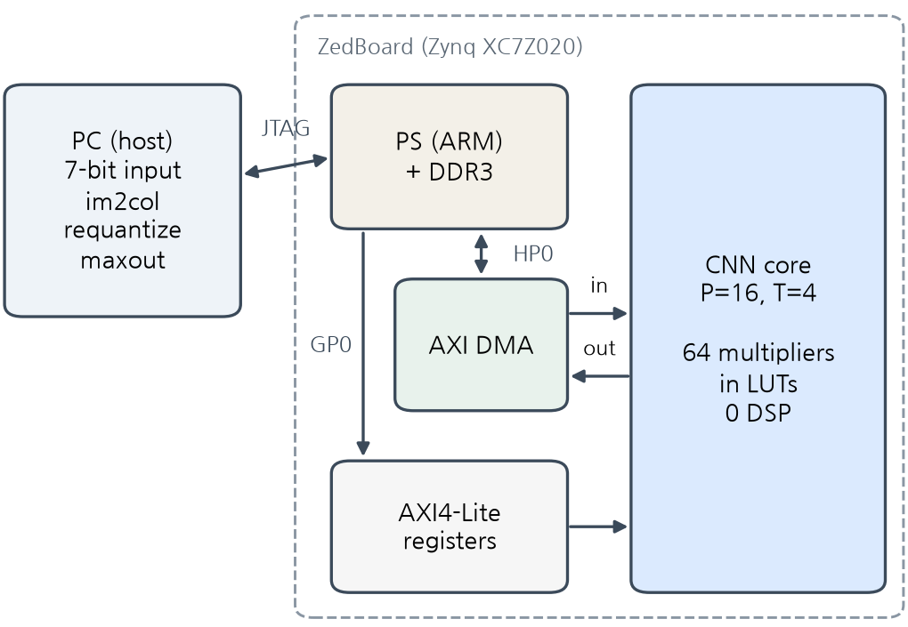
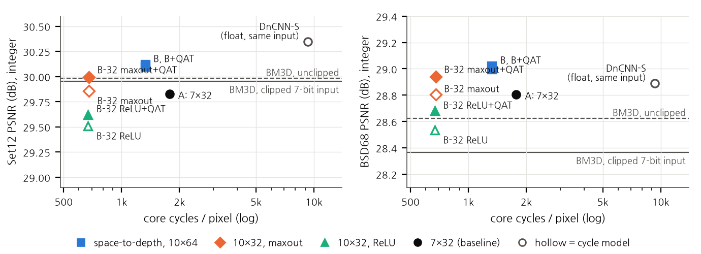

# Designing to the Bottleneck, Not the FLOPs: CNN Image Denoising on an Input-Bandwidth-Bound Small-FPGA Integer Accelerator

(Author), (Department, University), (e-mail)

> **Draft notes (remove before submission)**
>
> - 2026-10-15. Condensed from `PAPER_KO.md`; every number is from the committed files listed there. [MAXOUT] marks the sentences and table rows that the fixed-budget re-run (ReLU, averaging control, maxout; 120 epochs + 15 QAT epochs each) will fill.
> - 2026-10-16. Seed-1 fixed-budget result (integer, after QAT): ReLU 29.62 / 28.68, maxout 30.00 / 28.94 (logs, 2 decimals). Not filled in yet: the seed-1 ReLU run collapsed at epoch 26 and the plateau rule halved its rate four times during the recovery, so seeds 2 and 3 decide (rule in `ABSTRACT.md`). The line-buffer sentences now say what the model predicts (maxout stops being free; B becomes slower than A).
> - 2026-10-16, later. The speed model is now the fixed-budget `dn_d10_c32_us_mo_fx_qat` (board run 0 mismatches, 44,254,293 cycles), the arm of the controlled comparison; the B-32 ReLU + QAT network was also run on the board (43,811,412 cycles, 668.5 per pixel against 668.5 modelled). Seven models are now verified on the board. The ReLU and averaging rows stay [MAXOUT] until seeds 2 and 3.
> - Build into the workshop template: `python iweict2026/build_docx.py --tpl iweict2026/template_word.docx --src iweict2026/PAPER_EN.md --out iweict2026/PAPER_EN.docx --lang en --ack "<English acknowledgment>"`.
> - The board-output figure (Korean draft, Fig. 3) is left out for space.

## Abstract

Efficient neural networks are usually designed to minimize multiplications, but on a small accelerator the run time may be set by something else. We denoise Gaussian noise (σ=25) on our integer CNN accelerator for a Zynq XC7Z020 FPGA (64 multipliers, one bitstream, 7-bit inputs) and show how the measured bottleneck changes the network design. A cycle model, within 0.003% of the board after two corrections, shows that this build, which receives host-built windows one value per cycle, is bound by its input port: a window of K input values costs K cycles for up to 64 output channels. A 7-layer DnCNN-style baseline therefore uses 41% of the multipliers, and two choices that look wasteful by FLOP count pay off. A 2×2 space-to-depth input fits a 10-layer, 64-channel network (6.4× the parameters, 1.6× the multiplications) in 25% fewer cycles, 0.3 dB higher on Set12. Maxout, which doubles a layer's multiplications, becomes extra output channels: on the board a 64-output maxout layer took 289 cycles per window, as a 32-output ReLU layer did, and for 1% more cycles the maxout network denoises better than the ReLU network of the same width [MAXOUT]. With quantization-aware training that reproduces the board's arithmetic, the quality-first integer model reaches 30.12 / 29.02 dB (Set12 / BSD68), above BM3D on the same clipped input (29.95 / 28.37 dB; 29.98 / 28.62 dB unclipped), and the speed-first model matches BM3D in 2.63× fewer cycles. Seven models were verified bit for bit on the board. With on-chip line buffers, the same model predicts that maxout stops being free and network B becomes slower than the baseline: the best network follows the bottleneck.

**Keywords** — image denoising, CNN accelerator, FPGA, hardware-aware network design, maxout, quantization-aware training

## I. Introduction

CNN denoisers such as DnCNN [1] outperform the classical BM3D [2] but need tens of thousands of multiplications per pixel, and networks for an accelerator are usually chosen by their multiplication or parameter count. That count is known not to set the run time. The roofline model [3] explains why kernels of low arithmetic intensity are bound by bandwidth rather than compute; ShuffleNet V2 [4] derived design rules from measured GPU speed; EfficientNet-X [5] analysed the gap between FLOPs and latency on TPUs and GPUs and used space-to-depth to raise accelerator utilization; and ABPN [6] built an INT8 super-resolution network from operator latencies measured on a mobile NPU. FPGA CNN accelerators remove memory-bandwidth bottlenecks with on-chip pipelines and line buffers [7]; eCNN [8] co-designed restoration networks with a DRAM-bandwidth-limited accelerator; and light CNN denoisers have been put on Zynq-class FPGAs [9], [10] and on a vendor DPU with INT8 quantization-aware training [11]. These works measure latency on GPUs, TPUs, NPUs or DPUs, or model DRAM traffic.

We study the same principle at a smaller scale and at cycle level, on an integer CNN core of our own design for a Zynq XC7Z020: 64 multipliers, one bitstream that runs every layer with only its shape changed, 7-bit unsigned inputs and a ReLU on every output. Because its input port takes one value per cycle, a window costs the number of values streamed, K, and output channels up to the multiplier count cost nothing. Our contributions are:

1. a cycle model, validated on the board, that separates what is free on this core (output channels up to 64, kernel shape, resampling, host-side operations) from what costs (K);
2. an iso-cycle comparison of two choices that this model favours although they look wasteful by FLOP count: space-to-depth, which fits a 6.4× larger network in 25% fewer cycles, and maxout in the free output channels, whose hidden layers keep their cycle count on the board;
3. integer models, trained with quantization-aware training that reproduces the board's arithmetic, that beat BM3D on the same input, verified bit for bit on the board.

Space-to-depth [12], [5], maxout [13]–[15] and quantization-aware training [16] are known techniques; our claim concerns the reason for choosing them. It holds for an input structure that receives host-built windows; with on-chip line buffers the same model predicts different choices (Section II).

## II. Accelerator and Cycle Model

*Fig. 1. System. The PC builds the windows (im2col) and requantizes between layers; the core in the PL computes every convolution.*

**Core.** The core receives one window of K activations and computes ReLU(b + Σ w·x) for COUT output channels, with INT8 weights, INT32 accumulation and 7-bit activations. Its 64 multipliers are P = 16 output-channel lanes times T = 4 tap banks; K ≤ 1152 and COUT ≤ 128 are set per run, and the same bitstream also runs a CIFAR-10 classifier. The design uses 21% of the LUTs and 51% of the BRAM; synthesis was not restricted, but Vivado built every 8-bit multiplier from LUTs, so no DSP slice is used. Timing closes at 100 MHz (WNS +0.221 ns); the board runs use the 50 MHz default clock, and a run at 100 MHz gave the same cycle count as at 50 MHz (0.44 s of core time).

**Cycle model.** The input port accepts one value per cycle; output channels are processed P at a time in ⌈K/T⌉ cycles per group while the next window loads. A window therefore costs

  C = max( K, ⌈COUT/P⌉ · ⌈K/T⌉ ).   (1)

When K dominates, the core is input-bound and up to P·T = 64 output channels cost nothing: at K = 288, COUT = 32 and 64 both take 288 cycles. On the baseline network the board showed one cycle more per window and at least COUT cycles per window (outputs leave one per cycle). With these two corrections, (1) predicted the total cycles of three networks designed afterwards within 0.003% (Table II), against 0.7–1.6% without them. Equation (1) is the dense-mode bound. All board runs used the sparse mode, which skips multiplications by zero activations and so shortens only the compute term; input-bound layers take the same cycles in both modes.

**Where the bottleneck comes from.** One value per cycle is a choice of the AXI-Stream wrapper, which unpacks four 7-bit values per 32-bit beat, made to reuse the CIFAR-10 bitstream unchanged. With w values per cycle, about P·T/w output channels come free (64, 32 and 16 for w = 1, 2, 4). Host-built windows have the same effect. With on-chip line buffers [7], a window brings only its new column of C_in values; by the dense model a hidden layer with K = 288 then costs 145 cycles at COUT = 32 and 289 at COUT = 64, maxout doubles the cost, and the baseline (833 cycles/pixel) becomes faster than network B (1,208). These are predictions, not measurements. The rules below therefore hold for this input structure; what carries over is choosing networks by the measured bottleneck. The host's share is small but not zero: im2col, requantization and maxout take 0.07–0.13 s per 256×256 image on a 4-core PC, 5–9% of the 50 MHz core time.

## III. Networks Designed to the Bottleneck

**Baseline (A).** A 7-layer, 32-channel 3×3 network derived from DnCNN, with BatchNorm folded. Inputs are clipped to [0, 1] and quantized to 7 bits in training and test. Every output passes a ReLU, so the network cannot predict signed noise as DnCNN does; the last layer outputs the clean image and receives the noisy image as an extra input. A's hidden layers (K = 288, COUT = 32) need 144 cycles of compute but 288 of input, so its multipliers are 41% utilized and more multipliers would not make it faster.

**Space-to-depth (B).** As in FFDNet [12], the image is split into its four 2×2 phases and processed at half resolution. With a quarter of the windows, a 10-layer, 64-channel network fits; its hidden layers (K = 576, COUT = 64) balance input and compute exactly, and the network is 88% utilized. It has 6.4× A's parameters and 1.6× its multiplications in 25% fewer cycles, so its gain over A is that of a larger network that space-to-depth makes affordable, not of the resampling alone.

**Maxout in free output channels (B-32 + maxout).** At 32 channels, B's hidden layers return to K = 288 and up to 64 outputs are free again. Each hidden layer computes two candidates per channel, and the host keeps the larger after requantization,

  max(ReLU(a), ReLU(b)) = ReLU(max(a, b)),   (2)

which is maxout [13] in its Max-Feature-Map form [17]. The next layer's K is unchanged, so hidden layers keep their cycle count; only the first layer (K = 36 < 64) grows to 64 cycles per window, 1% per pixel. In restoration the benefit of maxout depends on width: it halved the filters at equal quality in super-resolution [14] and was about 0.04 dB below ReLU in a 64-channel space-to-depth denoiser [15]. Requantization is monotonic per channel, so (2) on codes is the requantized maximum.

**Training and quantization.** We train on 380 Train400 [1] images, holding out every 20th for validation, with 40×40 (A) or 50×50 patches, flips, rotations, MSE and Adam (10⁻³, batch 128), halving the rate after 6 epochs without validation gain. Weights are per-channel symmetric INT8 and activations 7-bit with one scale per map [16], chosen from percentiles on training images. A module that reproduces the board's integer arithmetic in float (rounding, bias units, skip-scale folding, maxout after requantization, 8-bit output) is then fine-tuned for 15 epochs with straight-through gradients and learned scales [18]; its PSNR matches the integer model within 0.001 dB. No checkpoint, learning-rate step or quantization range was chosen on Set12 or BSD68.

## IV. Verification

The RTL was verified in a UVM [19] environment (AXI4-Lite and AXI4-Stream agents, a scoreboard that predicts from a reference model, coverage and handshake assertions) on Verilator: 39 runs under UVM 1.2 and 26 under IEEE 1800.2-2020 passed, and all ten injected bugs were caught. On the board, every layer's output is compared value by value with the integer model, and the final PSNR must equal the integer model's; every board figure below passed this check.

## V. Results

**Setup.** Set12 and BSD68 [20] at σ = 25, with the same noise for every method, clipped and quantized to 7 bits. This input is the CNNs' training distribution but not BM3D's: on unclipped noise BM3D gains 0.03 / 0.26 dB (Set12 / BSD68), and tuning its σ changes it by under 0.1 dB, so Table I lists both. As a CNN reference on the same input we evaluate the public DnCNN-S weights [1] (float, trained on unclipped noise). Integer PSNR is that of the integer model, which the board reproduces bit for bit; with one training seed, differences under 0.1 dB are not interpreted.

*Table I. Mean PSNR (dB) and core cost. Cycles are the corrected model; "board" marks networks whose cycles were measured. B-32 rows train for a fixed 120 epochs (seed 1).*

| Model | Cycles/px | Util. | Params | Set12 float / int | BSD68 float / int |
|---|---|---|---|---|---|
| BM3D [2], clipped input | — | — | — | 29.95 | 28.37 |
| BM3D, unclipped | — | — | — | 29.98 | 28.62 |
| DnCNN-S [1], same input | 9.3k | — | 556k | 30.35 | 28.89 |
| A: 7 × 32 | 1,775 board | 41% | 47k | 29.87 / 29.83 | 28.83 / 28.80 |
| **B + QAT: s2d, 10 × 64** | 1,323 board | 88% | 300k | 30.13 / **30.12** | 29.01 / **29.02** |
| **B-32 + maxout + QAT** | 675 board | 87% | 152k | 30.00 / **30.00** | 28.95 / **28.94** |
| B-32 ReLU + QAT [MAXOUT] | 669 board | 45% | 76k | — | — |
| B-32 averaging + QAT [MAXOUT] | 675 | 87% | 152k | — | — |

*Fig. 2. Integer PSNR against core cycles per pixel (left Set12, right BSD68). Filled markers are board-measured cycles. At about 670 cycles maxout lies above ReLU, and B lies above and to the left of A.*

**Quality model.** B + QAT reaches 30.12 / 29.02 dB: +0.17 / +0.66 dB over BM3D on the same input (better on 10/12 and 68/68 images), +0.14 / +0.40 dB over unclipped BM3D, and +0.29 / +0.22 dB over A on all 80 images, in 1.34× fewer cycles.

**Speed model.** B-32 + maxout + QAT needs 2.63× fewer cycles than A and scores 30.00 / 28.94 dB, +0.17 / +0.14 dB above A: level with BM3D on Set12 (9/12 images) and +0.57 dB on BSD68 (+0.32 dB unclipped).

**Maxout against ReLU and averaging.** [MAXOUT] A first comparison overstated the gain (+0.54 / +0.35 dB): its ReLU network had stopped early after 4k updates against 18k for maxout, and retrained for a fixed 120 epochs it rises from 29.18 to 29.55 dB (Set12, float). The last three rows of Table I therefore share one budget and QAT, and the averaging control keeps the same 64 outputs per hidden layer but combines each pair by its mean after requantization, so it has the same parameters and cycles and lacks only the max.

**Quantization and the same-input reference.** QAT brought every integer model within 0.04 dB of its float model; the maxout network had lost 0.16 / 0.14 dB before it. DnCNN-S on the same input scores 30.35 / 28.89 dB in float with 556k parameters, 0.2 dB above our 300k integer model on Set12 (its BSD68 deficit reflects training on unclipped noise). On this core DnCNN-S would cost about 9.3k cycles per pixel, 7.0× the quality model.

*Table II. Board runs (Set12 05.png, 256×256, 50 MHz, no mismatch in any layer). Core time: 2.33, 1.73, 0.89 and 0.88 s.*

| Model | Hidden K / COUT | Cycles/window, model → board | Cycles/px | PSNR |
|---|---|---|---|---|
| A | 288 / 32 | 288 → 289 | 1,775 | 29.83 |
| B + QAT | 576 / 64 | 576 → 577 | 1,323 | 30.06 |
| B-32 + maxout + QAT | 288 / **64** | 288 → **289** | 675 | 29.94 |
| B-32 ReLU + QAT | 288 / 32 | 288 → 289 | 669 | 29.54 |

**Board.** The maxout layers (K = 288, 64 outputs) took 289 cycles per window, exactly as the 32-output layers of A and of the ReLU network: doubling the outputs cost nothing on the board, and the whole network took 1.01× the ReLU network's cycles (Table II). Absolute throughput is low: 6.4 GOPS at most at 50 MHz and 0.9–2.3 s of core time per 256×256 image, against 30–38 ms for float PyTorch on a 4-core PC CPU. The JTAG test harness dominates wall-clock time, and the on-chip ARM was not compared; this paper concerns choosing networks for a given core, not throughput.

## VI. Conclusion

On a 64-multiplier integer core, a cycle model that matches the board showed that the bottleneck is the input port, not the multipliers, and two choices that look wasteful by FLOP count paid off: space-to-depth fitted a 6.4× larger network into 25% fewer cycles, and maxout used free output channels at no hidden-layer cost [MAXOUT]. The quality model beats BM3D on the same input on both test sets, the speed model matches it in 2.63× fewer cycles, and seven models were verified bit for bit on the board. The result belongs to an input structure fed by host-built windows; with line buffers the cycle model predicts that maxout stops being free and B becomes slower than A, which we will measure next. Energy, end-to-end time without the test harness, other noise levels, more seeds, color images and SSIM are not reported. Code, integer models, per-image PSNR and board logs are in the project repository.

**Acknowledgment.** This study was conducted with the support of the Ministry of Science and ICT and the Institute for Information & Communications Technology Planning & Evaluation (IITP) under the 'SW-oriented University Program.'

## References

[1] K. Zhang, W. Zuo, Y. Chen, D. Meng, and L. Zhang, "Beyond a Gaussian denoiser: Residual learning of deep CNN for image denoising," *IEEE Trans. Image Process.*, vol. 26, no. 7, pp. 3142–3155, 2017.

[2] K. Dabov, A. Foi, V. Katkovnik, and K. Egiazarian, "Image denoising by sparse 3-D transform-domain collaborative filtering," *IEEE Trans. Image Process.*, vol. 16, no. 8, pp. 2080–2095, 2007.

[3] S. Williams, A. Waterman, and D. Patterson, "Roofline: An insightful visual performance model for multicore architectures," *Commun. ACM*, vol. 52, no. 4, pp. 65–76, 2009.

[4] N. Ma, X. Zhang, H.-T. Zheng, and J. Sun, "ShuffleNet V2: Practical guidelines for efficient CNN architecture design," in *Proc. ECCV*, 2018.

[5] S. Li, M. Tan, R. Pang, A. Li, L. Cheng, Q. V. Le, and N. P. Jouppi, "Searching for fast model families on datacenter accelerators," in *Proc. CVPR*, 2021, pp. 8085–8095.

[6] Z. Du, J. Liu, J. Tang, and G. Wu, "Anchor-based plain net for mobile image super-resolution," in *Proc. CVPR Workshops*, 2021, pp. 2494–2502.

[7] D. Wang, K. Xu, and D. Jiang, "PipeCNN: An OpenCL-based open-source FPGA accelerator for convolution neural networks," in *Proc. Int. Conf. Field-Programmable Technology (FPT)*, 2017.

[8] C.-T. Huang, Y.-C. Ding, H.-C. Wang, C.-W. Weng, K.-P. Lin, L.-W. Wang, and L.-D. Chen, "eCNN: A block-based and highly-parallel CNN accelerator for edge inference," in *Proc. MICRO*, 2019, pp. 182–195.

[9] W. Kang et al., "Improvement and hardware design of image denoising algorithm based on deep learning," in *Proc. Int. Conf. Integrated Circuits and Microsystems (ICICM)*, 2024, pp. 671–676.

[10] L. Tu, Y. Gu, X. Huang, and X. Wu, "Lightweight design of image denoising based on TNet mini," in *Proc. Int. Symp. Artificial Intelligence and Intelligent Manufacturing (AIIM)*, 2024, pp. 646–649.

[11] C. Li, C. Bled, R. Fernandez, and S. Shanker, "ReTiDe: Real-time denoising for energy-efficient motion picture processing with FPGAs," in *Proc. ACM SIGGRAPH European Conf. Visual Media Production (CVMP)*, 2025.

[12] K. Zhang, W. Zuo, and L. Zhang, "FFDNet: Toward a fast and flexible solution for CNN-based image denoising," *IEEE Trans. Image Process.*, vol. 27, no. 9, pp. 4608–4622, 2018.

[13] I. J. Goodfellow, D. Warde-Farley, M. Mirza, A. Courville, and Y. Bengio, "Maxout networks," in *Proc. ICML*, 2013.

[14] J.-S. Choi and M. Kim, "Single image super-resolution using lightweight CNN with maxout units," in *Proc. ACCV*, 2018 (LNCS, Springer, 2019), pp. 471–487.

[15] S. Gu, W. Li, L. Van Gool, and R. Timofte, "Fast image restoration with multi-bin trainable linear units," in *Proc. ICCV*, 2019, pp. 4190–4199.

[16] B. Jacob et al., "Quantization and training of neural networks for efficient integer-arithmetic-only inference," in *Proc. CVPR*, 2018.

[17] X. Wu, R. He, Z. Sun, and T. Tan, "A light CNN for deep face representation with noisy labels," *IEEE Trans. Inf. Forensics Security*, vol. 13, no. 11, pp. 2884–2896, 2018.

[18] S. K. Esser, J. L. McKinstry, D. Bablani, R. Appuswamy, and D. S. Modha, "Learned step size quantization," in *Proc. ICLR*, 2020.

[19] *IEEE Standard for Universal Verification Methodology Language Reference Manual*, IEEE Std 1800.2-2020.

[20] D. Martin, C. Fowlkes, D. Tal, and J. Malik, "A database of human segmented natural images and its application to evaluating segmentation algorithms and measuring ecological statistics," in *Proc. ICCV*, 2001.
