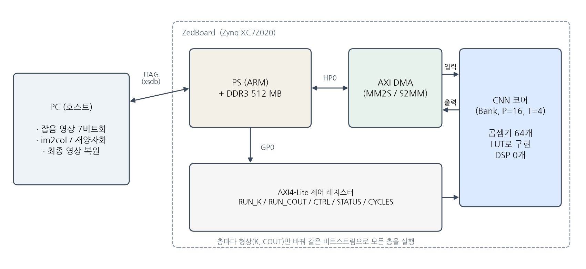
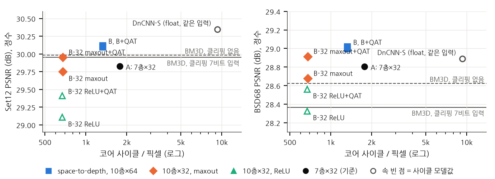

# 연산량이 아닌 병목으로 설계하기: 입력 대역에 묶인 소형 FPGA 정수 가속기에서의 CNN 영상 잡음 제거

*(영문 제목: Designing to the Bottleneck, Not the FLOPs: CNN Image Denoising on an Input-Bandwidth-Bound Small-FPGA Integer Accelerator)*

(저자 이름), (소속: 학과, 대학교), (이메일)

> **초안 메모 — 제출 전에 확정할 것**
>
> - 2026-10-14 판. 6개 관점의 심사 패널과 24개 지적의 반박 검증을 거쳐 고쳤다. 모든 수치는 저장소의 `denoise/export/*/int_eval.json`, `denoise/board_runs/*.json`, `denoise/bm3d_protocol.json`, `denoise/dncnn_s_protocol.json`에서 나온 것이며, `python denoise/results_table.py`가 표 I을 다시 만든다.
> - 영문 4쪽(IEEE 2단)으로 옮길 때 줄일 순서: 표 II의 층별 행(모델당 한 행으로) → V절 U-Net 문단 → 참고문헌 주석. IV절(검증)은 줄이지 않는다.
> - 사사(acknowledgment)의 AI 도구 사용 고지는 저자가 결정한다(아래 문장은 안).

---

## 초록

효율적인 신경망은 보통 곱셈 수를 최소화하도록 설계되지만, 소형 가속기에서는 실행 시간이 다른 것으로 정해질 수 있다. 본 연구는 소형 FPGA용 정수 CNN 가속기(Zynq XC7Z020: 곱셈기 64개, 단일 비트스트림, 7비트 입력, ReLU 출력)에서 가우시안 잡음(σ=25)을 제거하며, 측정된 병목이 망 설계를 어떻게 바꾸는지 보인다. 사이클 모델(설계 단계에서 1.7% 이내, 이전 보드 실행에서 관찰한 보정 두 개를 넣으면 0.003% 이내)은 이 구현이 사이클당 7비트 값 하나를 받는 입력 포트에 묶여 있음을 보인다. 즉 한 층의 비용은 창당 K 사이클이며(K는 입력 값의 수), 출력 채널 수는 곱셈기 수(64)까지 비용에 영향을 주지 않는다. 그래서 7층 DnCNN 형태의 기준 망은 곱셈기의 41%만 쓴다. 여기서 연산량(FLOP) 기준으로는 낭비로 보이는 두 가지 선택이 나온다. 2×2 space-to-depth 입력은 10층 64채널 망(파라미터 6.4배, 곱셈 1.6배)을 기준 망보다 25% 적은 사이클에 돌리게 하며, 0.3 dB 높다. 층의 곱셈을 2배로 만드는 maxout은 모든 은닉층의 추가 출력 채널이 된다. 보드에서 출력 64채널 maxout 층은 창당 289 사이클로 출력 32채널 ReLU 층과 같았고, 픽셀당 1% 많은 사이클(675 대 668)로 maxout 망은 같은 양자화 인지 학습을 거친 ReLU 망보다 +0.54 / +0.35 dB(Set12 / BSD68) 높다. 보드 연산을 재현한 그 학습은 모든 정수 모델을 float의 0.04 dB 안으로 가져왔다. 화질 우선 정수 모델은 30.12 / 29.02 dB로, 같은 클리핑 7비트 입력에서 측정한 BM3D(29.95 / 28.37 dB, 클리핑 없이는 29.98 / 28.62 dB)보다 높다. 속도 우선 모델은 기준 망보다 2.63배 적은 코어 사이클로 29.95 / 28.91 dB다. 모델당 Set12 한 장을 보드에서 끝까지 실행했고, 모든 층이 정수 모델과 비트 단위로 일치했다.

**주제어** — 영상 잡음 제거, CNN 가속기, FPGA, 하드웨어 인지 신경망 설계, maxout, 양자화 인지 학습

---

## I. 서론

DnCNN [2] 같은 CNN 잡음 제거기는 고전 기법 BM3D [1]보다 화질이 좋지만 픽셀마다 수만 번의 곱셈이 필요하다. 가속기에 올릴 망을 고를 때는 보통 곱셈 수(FLOPs)나 파라미터 수를 비용으로 삼는다. 그러나 연산량과 실제 지연이 비례하지 않는다는 것은 알려져 있다. Roofline 모델 [12]은 연산 강도가 낮은 커널은 연산기가 아니라 대역폭에 묶인다고 설명하고, ShuffleNet V2 [9]는 GPU 실측 속도로 설계 지침을 세웠으며, EfficientNet-X [13]는 TPU/GPU에서 FLOPs와 지연의 비비례를 분석해 space-to-depth를 가속기 활용도를 위해 썼고, ABPN [14]은 모바일 NPU에서 연산자별 지연을 재어 INT8 초해상도 망을 설계했다. 영상 복원에서는 eCNN/ERNet [15]이 DRAM 대역폭 제약에 맞춰 복원망을 공동 설계했고, 양자화 DnCNN을 Zynq급 FPGA에 올린 보고 [18], [19]와 벤더 DPU에서 INT8 양자화 인지 학습으로 잡음을 제거한 ReTiDe [20]가 있다. 이들은 GPU, TPU, NPU, 벤더 DPU의 측정 지연이나 DRAM 대역폭을 다뤘다.

본 연구는 같은 원리를 더 작은 규모에서, 사이클 단위로 다룬다. 가속기는 Zynq XC7Z020에 올린 정수 CNN 코어로, 곱셈기가 64개이고 하나의 비트스트림이 층마다 형상만 레지스터로 바꿔 모든 층을 실행한다. 입력은 7비트 부호 없는 값, 모든 출력에는 ReLU가 걸린다. 현재 구현의 입력 포트는 사이클당 값 하나를 받으므로, 창 하나의 비용은 곱셈 수가 아니라 **스트리밍되는 값의 수 K**로 정해지고, 출력 채널은 곱셈기 수(64)까지 비용이 없다. 이 성질을 실측으로 확정한 사이클 모델에서 설계를 출발한다.

기여는 다음과 같다.

1. 이 코어에서 **공짜인 것과 비용인 것을 가르는 사이클 모델**. 설계 단계 모델은 보드 실측과 1.7% 이내, 이전 보드 실행에서 본 보정 두 개를 넣으면 0.003% 이내로 맞는다. 공짜 집합은 출력 채널(≤ 64), 커널 모양, 리샘플링, host 쪽 비선형과 양자화기이고, 비용은 K다.
2. 그 모델이 가리키는, **연산량 기준으로는 손해인 두 선택**을 같은 사이클 축에서 비교한 표(iso-cycle 비교). space-to-depth는 6.4배 큰 망을 25% 적은 사이클에 넣고, maxout은 은닉층의 사이클을 바꾸지 않은 채(보드 실측 289 사이클/창, ReLU 층과 동일) 같은 학습·양자화 조건의 ReLU 망보다 Set12 +0.54, BSD68 +0.35 dB 높다.
3. 보드 연산을 그대로 재현한 양자화 인지 학습과 **보드에서의 비트 단위 검증**. 정수 모델은 같은 입력 조건의 BM3D를 넘고(30.12 / 29.02 dB), 속도 우선 모델은 기준 망보다 2.63배 적은 사이클로 BM3D 수준이다(29.95 / 28.91 dB).

space-to-depth [3], [13], maxout [4], [16], [17], 양자화 인지 학습 [5] 자체는 알려진 기법이다. 본 연구의 주장은 기법이 아니라 **선택의 근거**다. 측정된 병목이 설계 규칙을 뒤집는다는 것을 작은 코어에서 사이클 단위로, 비트 단위로 검증한 사례 연구다.

## II. 가속기와 사이클 모델

*그림 1. 시스템 구성. PC가 창(im2col)과 층 간 재양자화를 맡고, PL의 코어가 모든 합성곱을 계산한다.*

**연산.** 코어는 창 하나(활성값 K개)를 받아 COUT개 채널의 `ReLU(b + Σ w·x)`를 계산한다. 가중치 INT8, 누산 INT32, 활성값 7비트. 곱셈기는 출력 채널 P=16개 × 탭 뱅크 T=4개 = 64개이다. 런타임 형상은 K ≤ 1152, COUT ≤ 128이고, 같은 비트스트림으로 CIFAR-10 분류망과 본 잡음 제거망을 모두 실행했다. 설계는 XC7Z020의 LUT 21%, BRAM 51%를 쓴다. DSP는 0개인데, 이는 합성 결과이지 설계 제약이 아니다. 타이밍은 100 MHz에서 닫혔고(WNS +0.221 ns), 측정은 PS 초기화 기본값인 50 MHz에서 했으며 한 모델은 100 MHz에서도 돌려 사이클 수가 같음을 확인했다(표 II).

**사이클 모델.** 입력 포트는 사이클당 값 하나를 받고, 출력 채널은 P개씩 묶어 묶음마다 ⌈K/T⌉ 사이클에 처리한다. 다음 창을 받는 동안 현재 창을 계산하므로 창 하나의 비용은

  cycles = max( K, ⌈COUT/P⌉ · ⌈K/T⌉ ).

K가 앞서면 코어는 **입력 대역에 묶인다**. 이때 COUT ≤ P·T = 64인 한 출력 채널은 사이클을 바꾸지 않는다. 예를 들어 K=288에서 COUT 32와 64는 둘 다 288 사이클이고, 128이면 576이다(COUT > 64는 보드에서 재지 않았고 RTL 시뮬레이션으로만 확인했다). 이런 해석적 비용 모델은 FPGA 가속기 설계에서 흔히 쓰이며 [8], 문헌의 모델 오차는 수 %대가 보통이다.

**실측 보정.** 기준 7층 망의 보드 실행에서 모든 층이 이 값보다 창당 1 사이클 많았고, 창당 최소 COUT 사이클이 걸렸다(코어가 출력을 사이클당 하나씩 내보내므로; 같은 현상을 CIFAR-10 실행에서도 보았다). 두 보정을 넣은 모델은 그 뒤에 설계한 10층 망 두 개의 총 사이클을 0.003% 이내로 예측했다(표 II). 보정 전 모델의 오차는 세 망에서 0.7–1.6%다.

**병목의 출처.** 입력 포트가 사이클당 값 하나인 것은 물리 제약이 아니라 현재 AXI-Stream 래퍼의 설계다. 32비트 비트 하나에는 7비트 값 4개가 실려 오고, 래퍼가 이를 1개/사이클로 풀어 코어에 넣는다. CIFAR-10용 비트스트림을 바꾸지 않고 재사용하려는 선택이었다. 포트를 4개/사이클로 넓히면 비용은 max(K/4, ⌈COUT/P⌉·⌈K/T⌉)가 되어 K=288, COUT=64인 층은 288 사이클(COUT=32이면 144)로 연산에 묶이고, 아래의 maxout은 더 이상 공짜가 아니다. 즉 본 논문의 규칙은 "이 포트 폭에서는"이라는 조건이 붙는다. 전달하려는 것은 규칙 자체가 아니라, 측정한 병목에 맞춰 망을 고르면 연산량 기준의 선택이 뒤집힌다는 방법이다.

**공짜인 것, 그리고 host의 몫.** 창을 PC가 만들기 때문에 창의 모양(팽창, 2×2 위상 분할, 임의의 탭 배치)은 코어 사이클이 아니다. 층 사이의 재양자화도 PC가 하므로 그 자리에서 하는 값별 연산(채널 쌍의 max, 채널의 공간 배치)도 코어 사이클이 아니다. 코어 사이클에는 오직 K가 든다. host의 몫은 0이 아니다. 256×256 영상 한 장에 층당 im2col 약 1 ms, 재양자화 약 3 ms, maxout의 max 약 0.2 ms로(4코어 PC, numpy) 장당 약 0.05 s이며, 코어 시간 0.89–1.73 s의 3–6%다. 창당 host 연산은 COUT + COUT/2 ≤ K이므로 스트리밍 단으로 하드웨어화해도 입력 한계 아래에 숨는다. 표 II의 벽시계 시간이 이보다 훨씬 긴 것은 JTAG 전송과 보드 쪽 검증 오라클 때문이다.

## III. 하드웨어에 맞춘 망 설계

**제약과 기본 망 (A).** DnCNN을 줄인 7층 × 32채널 3×3 망이다(배치 정규화는 합성곱에 합친다). 입력은 [0, 1]로 자르고 7비트로 양자화한다(학습과 평가에서 동일). 모든 출력에 ReLU가 걸리므로 DnCNN처럼 잡음(부호 있음)을 예측할 수 없다. 그래서 마지막 층이 **깨끗한 영상을 직접 출력**하고, 잡음 영상을 마지막 층에 한 채널 더 입력(skip)해서 "입력을 베끼고 고치는" 경로를 준다. 부호를 둘로 나눠 잡음을 예측하는 변형((w, b), (−w, −b) 두 채널)도 시험했지만 정수 변환에서 0.3 dB를 잃어 쓰지 않았다.

**병목 분석.** A의 중간 층(K=288, COUT=32)은 계산에 ⌈32/16⌉·72 = 144 사이클이면 되지만 입력을 받는 데 288 사이클이 걸린다. 망 전체로 곱셈기 활용률은 **41%**다. 현재 포트 폭에서는 곱셈기를 늘려도 빨라지지 않고, 줄여도 느려지지 않는다. 설계 방향은 둘이다. K를 줄이거나, 노는 곱셈기를 공짜로 쓰거나.

**space-to-depth (B).** FFDNet [3]처럼 영상을 2×2 위상으로 나눠 반쪽 해상도 4채널로 처리한다. 창 수가 1/4이 되므로, 같은 사이클 예산 안에 채널 64, 깊이 10층의 망이 들어간다. 중간 층은 K=576, COUT=64로 ⌈64/16⌉·144 = 576 = K: 입력 대역과 연산이 정확히 균형을 이룬다(활용률 89%). 파라미터는 A의 6.4배, 곱셈은 1.6배인데 사이클은 25% 적다. 이 비교에서 바뀐 것은 리샘플링만이 아니라 깊이·폭·파라미터이므로, 아래 표의 B 대 A 차이는 "space-to-depth 덕분에 더 큰 망이 더 적은 사이클에 들어간다"로 읽어야 한다.

**maxout (B-32+maxout).** B의 채널을 32로 줄이면 중간 층이 K=288로 돌아와 사이클이 B의 절반이 되지만, 다시 출력 채널 64까지가 공짜가 된다. 이 공짜 출력을 활성함수로 쓴다. 은닉층이 채널마다 후보 두 개를 계산하고(출력 64), PC가 재양자화할 때 큰 쪽만 다음 층으로 넘긴다(입력 32, K=288 유지).

  max(ReLU(a), ReLU(b)) = ReLU(max(a, b)).

이것이 maxout [4](Max-Feature-Map [10] 형태)이다. 복원망에서 maxout이 좁은 망에 유리하다는 것은 알려져 있다. Choi와 Kim [16]은 초해상도에서 maxout이 필터 수를 절반으로 줄여도 화질을 유지한다고 보였고, MTLU [17]의 비교에서는 64채널 망의 maxout이 ReLU와 0.04 dB 안에서 같았다. 그 이득을 대가 없이 가져오는 것이 이 코어의 특징이다. 일반 하드웨어에서 maxout은 층의 곱셈을 2배로 늘리지만, 여기서는 다음 층의 K가 그대로이므로 K ≥ COUT인 은닉층의 사이클이 그대로다(첫 층은 K=36 < 64라 창당 64 사이클이 되어 픽셀당 1%가 는다). 재양자화가 채널별 단조 함수이므로 코드의 max는 실수 값의 max를 재양자화한 것과 같다. 정수 모델과 보드 드라이버가 같은 순서로 계산한다.

**학습.** Train400 중 20장을 검증용으로 떼고 380장으로 학습한다. 40×40(A) 또는 50×50(B 계열) 패치, 뒤집기·회전, MSE, Adam(초기 10⁻³, 배치 128). 검증 PSNR이 6 epoch 동안 오르지 않으면 학습률을 반으로, 15 epoch 동안 오르지 않으면 종료한다. 검증 최고 모델을 쓰고, 테스트셋은 선택에 쓰지 않는다. 데이터, 증강, 손실, 학습률 규칙은 모든 망이 같고 epoch당 픽셀 수도 같지만(52.4M 대 51.2M), epoch당 갱신 횟수는 A 256, B 계열 160이고 총 예산은 최고 검증 epoch 기준 2–3만 갱신으로 DnCNN [2]의 약 1/4이다. 시드는 하나다.

**양자화와 양자화 인지 학습.** 정수 추론 [5]을 따른다. 가중치는 출력 채널별 대칭 INT8, 바이어스 INT32, 활성값은 층(맵)마다 스케일 하나를 갖는 7비트. 스케일은 먼저 검증 영상 40장에서 맵마다 퍼센타일을 골라 정하고(테스트셋은 쓰지 않음), 이어서 **보드의 정수 연산을 float 안에서 그대로 재현한 모듈**(INT8 가중치 반올림, 7비트 활성값 반올림, 바이어스 단위, skip 입력의 스케일 비 접기, 재양자화 뒤의 maxout, 8비트 출력)을 straight-through 추정으로 15 epoch 미세조정한다(학습률 10⁻⁴). 활성값 스케일은 학습 변수다(LSQ [6]). 검증은 양자화를 켠 채로 하므로 남는 모델이 곧 보드 모델이다. 같은 스케일을 주면 이 모듈과 정수 모델의 PSNR은 0.001 dB 안에서 같다. 이 방식 자체는 FINN/Brevitas나 hls4ml 계열의 비트 정확 에뮬레이션과 같은 관행이며, 본 코어에 맞춘 것은 7비트 부호 없는 활성값, 재양자화 뒤의 maxout, skip 스케일 접기다.

## IV. 검증

**RTL.** UVM [11] 환경(AXI4-Lite·AXI4-Stream 에이전트, 모니터에서 예측하는 참조 모델 스코어보드, 형상·모드·데이터·흐름 커버리지, AXI 핸드셰이크 assertion 8개)을 Verilator 5.052에서 돌렸다. 테스트 4종을 빌드 4개와 시드 2–3개로 실행해 UVM 1.2에서 39회, IEEE 1800.2-2020에서 26회 모두 통과했고(xsim은 돌리지 않았다), 출력 38,809개와 레지스터 읽기 7,114개를 비교했다. 일부러 넣은 버그 10개를 모두 검출했다. 형상 커버리지는 축소 빌드에서 89–100%, 보드 빌드에서는 17–29%이며 실제 층 형상은 지시 테스트로 덮었다.

**보드.** 층마다 보드 출력을 PC 정수 모델의 정답과 보드 쪽에서 값 하나하나 비교하고, 최종 PSNR이 정수 모델의 값과 같아야 통과한다. 본 논문의 모든 "보드" 수치는 이 검사를 통과한 것이다.

## V. 결과

**조건.** Set12(12장), BSD68 [7](68장), 가우시안 잡음 σ=25. 모든 기법에 같은 잡음 영상(고정 시드)을 **클리핑하고 7비트로 양자화해서** 넣었다. 이 조건은 CNN에는 학습 분포이지만 BM3D에는 아니다. 클리핑 없는 float 잡음에서 BM3D는 Set12 +0.03, BSD68 +0.26 dB 높고(포화 픽셀이 많은 영상에 집중), BM3D의 σ를 학습 영상에서 다시 골라도 차이는 0.1 dB 이내다. 표에는 두 값을 모두 적는다. 같은 입력에서의 CNN 기준선으로 공개 DnCNN-S [2] 가중치(17층 × 64, 556k, float, 클리핑 없이 학습)를 평가했다. 정수 PSNR은 보드와 같은 정수 연산을 PC에서 수행한 값이며, 모델당 Set12 05.png 한 장을 보드에서 끝까지 실행해 전 층 비트 일치를 확인했다(표 II). 자체 학습 로그에서 epoch 간 Set12 표준편차가 0.08–0.10 dB이므로, 0.1 dB 미만의 차이는 해석하지 않는다.

*표 I. 평균 PSNR(dB)과 코어 비용. 정수 = 보드와 같은 정수 연산의 값. 사이클은 보정 모델이며 "실측"은 보드에서 잰 모델(05.png)이다. 마지막 열은 정수 모델이 BM3D(클리핑 입력)보다 높은 사진 수.*

| 모델 | 사이클/px | 곱셈기 활용률 | 파라미터 | Set12 float / 정수 | BSD68 float / 정수 | > BM3D |
|---|---|---|---|---|---|---|
| BM3D [1], 클리핑 입력 | — | — | — | 29.95 | 28.37 | — |
| BM3D, 클리핑 없음 | — | — | — | 29.98 | 28.62 | — |
| DnCNN-S [2], 같은 입력 (float) | 9.3k (모델) | — | 556k | 30.35 | 28.89 | — |
| A: 7층 × 32 (기준) | 1,775 (실측) | 41% | 47k | 29.87 / 29.83 | 28.83 / 28.80 | 6/12, 60/68 |
| B: s2d, 10층 × 64 | 1,323 (실측) | 89% | 300k | 30.14 / 30.10 | 29.01 / 29.00 | 10/12, 68/68 |
| **B + QAT** (화질) | 1,323 (실측) | 89% | 300k | 30.13 / **30.12** | 29.01 / **29.02** | **10/12, 68/68** |
| B-32: s2d, 10층 × 32, ReLU | 668 | 44% | 76k | 29.18 / 29.11 | 28.28 / 28.33 | 0/12, 30/68 |
| B-32 + QAT | 668 | 44% | 76k | 29.43 / 29.41 | 28.52 / 28.56 | 1/12, 49/68 |
| B-32 + maxout | 675 (실측) | 87% | 152k | 29.97 / 29.75 | 28.92 / 28.68 | 5/12, 63/68 |
| **B-32 + maxout + QAT** (속도) | 675 (실측) | 87% | 152k | 29.98 / **29.95** | 28.93 / **28.91** | 8/12, **68/68** |

- **화질 모델(B+QAT):** 클리핑 BM3D보다 Set12 +0.17, BSD68 +0.65 dB(10/12, 68/68장). 클리핑 없는 BM3D보다도 +0.14 / +0.40 dB(10/12, 68/68). 기준 망 A보다 1.34배 적은 사이클로 +0.29 / +0.22 dB(12/12, 68/68).
- **속도 모델(B-32+maxout+QAT):** A보다 **2.63배** 적은 사이클로 Set12는 BM3D 수준(클리핑 기준 8/12장, 차이 0.01 dB 미만), BSD68은 클리핑 BM3D보다 +0.54, 클리핑 없는 BM3D보다 +0.29 dB(67/68). A와는 +0.12 / +0.11 dB로 동급이다.
- **maxout의 효과:** 같은 학습·QAT 조건의 ReLU 망(B-32+QAT)보다 Set12 **+0.54**, BSD68 **+0.35** dB, 80장 모두에서 높다. 사이클은 1% 많고(첫 층), 곱셈기 활용률은 44% → 87%. QAT 전 float끼리는 +0.79 / +0.64 dB였는데, QAT 15 epoch이 ReLU 망의 float 점수도 0.25 dB 올렸다(29.18 → 29.43). 즉 처음 격차의 일부는 활성함수가 아니라 학습 예산이었다. 또 이 비교는 파라미터가 2배(76k 대 152k)인 비교이기도 하다. 같은 64 출력을 max 대신 합으로 결합하는 대조군은 아직 돌리지 않았으므로, 이득이 max 비선형의 것인지 용량의 것인지는 가리지 못한다. 어느 쪽이든 "공짜 출력 채널을 화질로 바꿨다"는 결론은 같다. 7층 32채널 망에서의 15 epoch 비교에서는 마지막 5 epoch 평균 +0.02 dB로 차이가 없었다(최고 epoch 기준 +0.12, 스크린 변동 약 0.4 dB 안). 64채널 망에서는 출력 128이 K를 넘겨 공짜가 아니다.
- **QAT의 효과:** 정수 손실이 maxout 망 0.22 → 0.02, ReLU 망 0.08 → 0.02, B 0.04 → 0.01 dB로 모두 0.04 dB 이내가 됐다. 손실이 컸던 maxout 망에서 이득이 가장 크다(+0.20 / +0.24 dB, 77/80장).
- **같은 입력의 DnCNN-S:** float 556k 모델이 30.35 / 28.89 dB(클리핑 없는 입력에서는 30.44 / 29.24로 문헌 [2]와 같다). 본 화질 모델(정수, 300k)은 Set12에서 0.2 dB 낮고 BSD68에서 0.1 dB 높은데, 후자는 DnCNN-S가 클리핑 없이 학습된 탓이므로 이득으로 세지 않는다. DnCNN-S 형상(K=576, 17층)을 이 코어에 올리면 사이클 모델로 약 9.3k 사이클/px, 화질 모델의 7.0배다.

*그림 2. 코어 사이클/픽셀 대 정수 PSNR (왼쪽 Set12, 오른쪽 BSD68). 채운 점은 보드에서 잰 사이클, 속 빈 점은 사이클 모델값. 가로선은 BM3D(실선: 논문의 클리핑 7비트 입력, 점선: 클리핑 없음). 같은 사이클(약 670)에서 maxout 망이 ReLU 망 위에 있고, space-to-depth 망이 기준 망 A의 왼쪽 위에 있다.*

*표 II. 보드 실측 (Set12 05.png, 256×256, 모든 층 불일치 0). 코어 시간 = 사이클 / 클럭. 벽시계는 JTAG 전송과 보드 쪽 검증을 포함한 하네스 시간.*

| 모델 | 클럭 | 층 | K | COUT | 사이클/창 (모델→실측) | 총 사이클 | 코어 시간 | 벽시계 | 05.png PSNR |
|---|---|---|---|---|---|---|---|---|---|
| B + QAT | 50 MHz | conv1 / conv2–9 / conv10 | 36 / 576 / 612 | 64 / 64 / 4 | 36→64 / 576→577 / 612→613 | 86,721,997 (1,323/px) | 1.73 s | 600 s | 30.06 |
| B-32 + maxout + QAT | 50 MHz | conv1 / conv2–9 / conv10 | 36 / 288 / 324 | 64 / **64** / 4 | 36→64 / 288→**289** / 324→325 | 44,254,269 (675/px) | 0.89 s | 399 s | 29.87 |
| B-32 + maxout + QAT | 100 MHz | 같음 | | | 같음 | 44,254,269 | 0.44 s | 399 s | 29.87 |
| A | 50 MHz | conv1 / conv2–6 / conv7 | 9 / 288 / 297 | 32 / **32** / 1 | 9→32 / 288→**289** / 297→298 | 116,326,743 (1,775/px) | 2.33 s | 701 s | 29.83 |

- maxout 층(K=288, 출력 64)은 A의 K=288, 출력 32 층과 똑같이 **289 사이클/창**이다. 출력을 2배로 늘린 비용이 0임을 보드가 보여 준다. 첫 층(K=36)만 출력 64개를 내보내는 64 사이클이 걸린다.
- 보정 모델과 실측의 차이는 세 망 모두 0.003% 이내이며, 그 차이는 실행당 고정 비용(약 1,000 사이클)이다. 100 MHz에서 사이클 수는 50 MHz와 같다.
- 절대 처리량은 낮다. 50 MHz, 곱셈기 64개로 약 5.7 GOPS이며 256×256 한 장에 코어만 0.9–1.7 s다. 이 논문은 처리량이 아니라 주어진 코어에서 망을 고르는 근거를 다룬다. GOPS/W 비교는 범위 밖이다.

**같은 사이클의 다른 설계: 2단계 U-Net.** 리샘플링이 공짜라는 성질로 깊이를 1/16 해상도 층에 두는 2단계 U-Net(1,294 사이클/px, 669k 파라미터)도 구현해 30 epoch 스크린했다. 검증 PSNR 27.89 dB로 같은 epoch의 B(28.14)에 0.25 dB 뒤졌으나, 갱신 횟수가 100 대 160으로 달랐고 두 곡선 모두 상승 중이어서 결론은 아니며 보류했다. 공짜 집합 안의 선택도 결국 표에서 가려야 한다.

*그림 3. Set12 05.png. 왼쪽부터 원본, 잡음(20.23 dB), 가우시안 필터(26.23 dB), BM3D(29.40 dB), FPGA 보드 출력(B+QAT, 30.06 dB). 아래 줄은 확대 영역이다.*

## VI. 결론

곱셈기 64개의 소형 정수 가속기에서, 실측과 맞는 사이클 모델이 병목이 곱셈기가 아니라 입력 포트임을 보였다. 그 포트 폭에서는 연산량으로 손해인 두 설계가 이득이 됐다. space-to-depth는 6.4배 큰 망을 25% 적은 사이클에 넣었고, maxout은 은닉층의 사이클을 바꾸지 않고 같은 조건의 ReLU 망보다 Set12 0.54 dB를 올렸다. 양자화 인지 학습까지 더해, 같은 입력의 BM3D를 두 테스트셋에서 넘는 정수 모델(30.12 / 29.02 dB)과 기준보다 2.63배 적은 사이클로 BM3D 수준인 모델(29.95 / 28.91 dB)을 얻었고, 두 모델 모두 보드에서 한 장을 끝까지 실행해 전 층 비트 일치를 확인했다. 코드, 정수 모델, 사진별 PSNR, 보드 기록은 저장소에 있다.

**한계.** 사이클은 공짜지만 에너지는 아니다. maxout은 곱셈을 2배로 하므로 동적 전력이 늘 수 있고, 측정하지 않았다. 처리 시간은 코어 사이클만 세었고 end-to-end 시간은 JTAG 하네스 기준이다. 잡음은 σ=25 하나, 시드는 하나다. 규칙은 현재 포트 폭에 조건부이며 COUT > 64 영역과 다른 포트 폭은 보드에서 재지 않았다. 모든 PSNR은 클리핑한 7비트 입력 조건이다.

**사사(안).** 〔저자 결정〕 코드와 초안 작성에 AI 코딩 도구(Claude Code)를 사용했다. 설계 판단, 실험 설계, 보드 실행과 검증은 저자가 했다.

## 참고문헌

[1] K. Dabov, A. Foi, V. Katkovnik, and K. Egiazarian, "Image denoising by sparse 3-D transform-domain collaborative filtering," *IEEE Trans. Image Process.*, vol. 16, no. 8, pp. 2080–2095, 2007.

[2] K. Zhang, W. Zuo, Y. Chen, D. Meng, and L. Zhang, "Beyond a Gaussian denoiser: Residual learning of deep CNN for image denoising," *IEEE Trans. Image Process.*, vol. 26, no. 7, pp. 3142–3155, 2017.

[3] K. Zhang, W. Zuo, and L. Zhang, "FFDNet: Toward a fast and flexible solution for CNN-based image denoising," *IEEE Trans. Image Process.*, vol. 27, no. 9, pp. 4608–4622, 2018.

[4] I. J. Goodfellow, D. Warde-Farley, M. Mirza, A. Courville, and Y. Bengio, "Maxout networks," in *Proc. ICML*, 2013.

[5] B. Jacob et al., "Quantization and training of neural networks for efficient integer-arithmetic-only inference," in *Proc. CVPR*, 2018.

[6] S. K. Esser, J. L. McKinstry, D. Bablani, R. Appuswamy, and D. S. Modha, "Learned step size quantization," in *Proc. ICLR*, 2020.

[7] D. Martin, C. Fowlkes, D. Tal, and J. Malik, "A database of human segmented natural images and its application to evaluating segmentation algorithms and measuring ecological statistics," in *Proc. ICCV*, 2001.

[8] Y. Ma, Y. Cao, S. Vrudhula, and J.-s. Seo, "Optimizing loop operation and dataflow in FPGA acceleration of deep convolutional neural networks," in *Proc. FPGA*, 2017.

[9] N. Ma, X. Zhang, H.-T. Zheng, and J. Sun, "ShuffleNet V2: Practical guidelines for efficient CNN architecture design," in *Proc. ECCV*, 2018.

[10] X. Wu, R. He, Z. Sun, and T. Tan, "A light CNN for deep face representation with noisy labels," *IEEE Trans. Inf. Forensics Security*, vol. 13, no. 11, pp. 2884–2896, 2018.

[11] *IEEE Standard for Universal Verification Methodology Language Reference Manual*, IEEE Std 1800.2-2020.

[12] S. Williams, A. Waterman, and D. Patterson, "Roofline: An insightful visual performance model for multicore architectures," *Commun. ACM*, vol. 52, no. 4, pp. 65–76, 2009.

[13] S. Li, M. Tan, R. Pang, A. Li, L. Cheng, Q. V. Le, and N. P. Jouppi, "Searching for fast model families on datacenter accelerators," in *Proc. CVPR*, 2021, pp. 8085–8095.

[14] Z. Du, J. Liu, J. Tang, and G. Wu, "Anchor-based plain net for mobile image super-resolution," in *Proc. CVPR Workshops*, 2021, pp. 2494–2502.

[15] C.-T. Huang, Y.-C. Ding, H.-C. Wang, C.-W. Weng, K.-P. Lin, L.-W. Wang, and L.-D. Chen, "eCNN: A block-based and highly-parallel CNN accelerator for edge inference," in *Proc. MICRO*, 2019, pp. 182–195.

[16] J.-S. Choi and M. Kim, "Single image super-resolution using lightweight CNN with maxout units," in *Proc. ACCV*, 2018 (LNCS, Springer, 2019), pp. 471–487.

[17] S. Gu, W. Li, L. Van Gool, and R. Timofte, "Fast image restoration with multi-bin trainable linear units," in *Proc. ICCV*, 2019, pp. 4190–4199.

[18] W. Kang et al., "Improvement and hardware design of image denoising algorithm based on deep learning," in *Proc. Int. Conf. Integrated Circuits and Microsystems (ICICM)*, 2024, pp. 671–676.

[19] L. Tu, Y. Gu, X. Huang, and X. Wu, "Lightweight design of image denoising based on TNet mini," in *Proc. Int. Symp. Artificial Intelligence and Intelligent Manufacturing (AIIM)*, 2024, pp. 646–649.

[20] C. Li, C. Bled, R. Fernandez, and S. Shanker, "ReTiDe: Real-time denoising for energy-efficient motion picture processing with FPGAs," in *Proc. ACM SIGGRAPH European Conf. Visual Media Production (CVMP)*, 2025.
