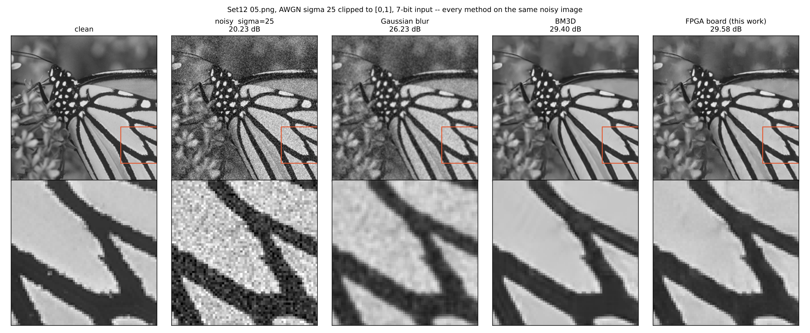

# 연산량이 아닌 병목으로 설계하기: 입력 대역에 묶인 소형 FPGA 정수 가속기에서의 CNN 영상 잡음 제거

*(영문 제목 안: Designing to the Bottleneck, Not the FLOPs: CNN Image Denoising on a Feed-Bound Small-FPGA Integer Accelerator)*

(저자 이름), (소속: 학과, 대학교), (이메일)

> **초안 메모 — 제출 전에 확정할 것**
>
> - 모든 수치는 최종 모델의 것이다(2026-10-13). 그림 2는 아직 이전 모델(7층)의 보드 출력이며, 최종 모델의 보드 출력으로 바꾼다(`make_figure.py --model dn_d10_c64_us_es_qat --board build/denoise_run_b_qat`).
> - 영문 4쪽(IEEE 2단 템플릿)에 맞추면서 분량을 조정한다. 넘치면 IV절(검증)과 표 III의 층별 행을 줄인다.

---

## 초록

효율적인 신경망은 흔히 곱셈 수(연산량)를 줄이는 방향으로 설계된다. 그러나 소형 가속기에서 실제 실행 시간을 정하는 것은 연산량이 아닐 수 있다. 본 연구는 소형 FPGA(Zynq XC7Z020)의 정수 CNN 가속기(곱셈기 64개, 단일 비트스트림, 7비트 입력, ReLU 출력)로 영상 잡음 제거를 수행하며, 이 차이가 망 설계를 어떻게 바꾸는지 보인다. 설계 단계의 사이클 모델은 보드 실측과 0.002% 이내로 일치하며, 코어가 입력 포트에 묶여 비용이 층 입력 값의 수 K로 정해지고 출력 채널 수에는 64까지 무관함을 보인다. 기준 7층 망은 곱셈기의 41%만 쓴다. 이에 따라 연산량 기준으로는 손해인 두 가지 선택을 적용했다. 첫째, 영상을 2×2 위상으로 나누는 space-to-depth로 창 수를 1/4로 줄이고 채널을 2배로 늘렸다. 곱셈은 1.6배지만 사이클은 25% 줄고 화질은 올랐다. 둘째, 연산이 2배라는 이유로 쓰이지 않던 maxout 활성함수를 은닉층의 출력 채널로 구현했다. 보드 실측에서 출력 64채널의 maxout 층은 32채널 층과 같은 289 사이클/창이었고, 같은 675 사이클/픽셀에서 ReLU보다 Set12 +0.84 dB, BSD68 +0.59 dB 높았다(80장 모두). 보드 연산을 그대로 재현한 양자화 인지 학습은 정수 변환 손실을 0.22 dB에서 0.02 dB로 줄였다. 가우시안 잡음 σ=25에서 화질 우선 모델은 정수 기준 Set12 30.12 dB, BSD68 29.02 dB로 같은 입력 조건의 BM3D(29.95 / 28.37 dB)를 두 테스트셋 모두에서 넘었고, 속도 우선 모델은 기준 망보다 2.63배 빠르면서 Set12 29.95 dB로 BM3D와 같고 BSD68에서 0.55 dB 높았다. 두 모델 모두 보드에서 모든 층의 출력이 PC 정수 모델과 비트 단위로 일치했다.

**주제어** — 영상 잡음 제거, CNN 가속기, FPGA, 하드웨어 인지 신경망 설계, maxout, 양자화 인지 학습

---

## I. 서론

DnCNN [2] 같은 CNN 잡음 제거기는 고전 기법 BM3D [1]보다 화질이 좋지만 픽셀마다 수만 번의 곱셈이 필요해서, GPU가 없는 엣지 기기에서는 전용 가속기가 필요하다. 가속기에 올릴 망을 고를 때는 보통 곱셈 수(FLOPs)나 파라미터 수를 비용으로 삼는다. 그러나 연산량과 실제 속도가 다르다는 것은 알려져 있고(ShuffleNet V2 [9]), 작은 가속기에서는 그 차이가 설계를 바꿀 만큼 크다.

본 연구의 가속기는 Zynq XC7Z020에 올린 정수 CNN 코어다. 곱셈기 64개를 DSP 없이 LUT로 구현했고, 하나의 비트스트림이 층마다 형상만 레지스터로 바꿔 모든 층을 실행한다. 입력은 7비트 부호 없는 값, 모든 출력에는 ReLU가 걸린다. 이 코어는 입력 포트가 사이클당 값 하나를 받기 때문에, 창 하나의 비용은 곱셈 수가 아니라 **스트리밍되는 값의 수 K**로 정해지고, 출력 채널은 64개까지 비용이 없다. 이 성질을 실측으로 확인한 사이클 모델이 본 연구의 출발점이다.

기여는 다음과 같다.

1. **실측과 0.002% 이내로 맞는 사이클 모델**로, 이 코어에서 공짜인 것(출력 채널 ≤ 64, 커널 모양, 리샘플링, host 쪽 비선형과 양자화기)과 비용인 것(K)을 가른다.
2. 그 결과 **연산량 기준으로는 손해인 두 선택**이 실제로는 이득임을 보드에서 보인다. space-to-depth(곱셈 1.6배, 사이클 −25%, 화질 +0.27 dB)와, 연산 2배라서 버려졌던 **maxout**(사이클 +0, Set12 +0.84 dB).
3. 보드 연산을 그대로 재현한 **양자화 인지 학습**으로 정수 손실을 0.22 → 0.02 dB로 없앤다.
4. 결과 모델을 **보드에서 비트 단위로 검증**한다. 화질 모델은 같은 조건의 BM3D를 두 테스트셋 모두에서 넘고(Set12 30.12, BSD68 29.02 dB), 속도 모델은 기준 망보다 2.63배 빠르면서 BM3D와 같은 화질이다.

space-to-depth(FFDNet [3]), maxout [4], 양자화 인지 학습 [5] 자체는 알려진 기법이다. 본 연구의 주장은 기법이 아니라 **선택의 근거**다. 측정된 병목이 설계 규칙을 뒤집는다는 것을, 같은 사이클에서 비교한 표(iso-cycle sweep)로 보인다.

## II. 가속기와 사이클 모델

*그림 1. 시스템 구성. PC가 창(im2col)과 층 간 재양자화를 맡고, PL의 코어가 모든 합성곱을 계산한다.*

**연산.** 코어는 창 하나(활성값 K개)를 받아 COUT개 채널의 `ReLU(b + Σ w·x)`를 계산한다. 가중치 INT8, 누산 INT32, 활성값 7비트. 곱셈기는 출력 채널 16개(P) × 탭 뱅크 4개(T) = 64개이다. 런타임 형상은 K ≤ 1152, COUT ≤ 128이고, 같은 비트스트림으로 CIFAR-10 분류망과 본 잡음 제거망을 모두 실행했다. 설계는 XC7Z020의 LUT 21%, BRAM 51%를 쓰고 DSP는 0개다. 100 MHz 제약에서 타이밍을 만족했고(WNS +0.221 ns), 측정은 보드 기본 클럭 50 MHz에서 했다.

**사이클 모델.** 입력 포트는 사이클당 값 하나를 받고, 출력 채널은 16개씩 묶어 묶음마다 ⌈K/4⌉ 사이클에 처리한다. 다음 창을 받는 동안 현재 창을 계산하므로 창 하나의 비용은

  cycles = max( K, ⌈COUT/16⌉ · ⌈K/4⌉ ).

K가 앞서면 코어는 **입력 대역에 묶인다**. 이때 COUT ≤ 64인 한 출력 채널은 사이클을 바꾸지 않는다. 예를 들어 K=288에서 COUT 32와 64는 둘 다 288 사이클이고, 128이면 576이다.

**실측 보정.** 보드에서 잰 모든 층은 이 값보다 창당 1 사이클 많았고, 창당 최소 COUT 사이클이 걸렸다(코어가 출력을 사이클당 하나씩 내보내므로; K=36, COUT=64인 첫 층이 64). 두 보정을 넣은 모델은 본 논문의 세 망(7층, 10층 두 가지)의 측정 총 사이클과 0.002% 이내로 일치한다(표 III).

**공짜인 것.** 창을 PC가 만들기 때문에 창의 모양(팽창, 2×2 위상 분할, 임의의 탭 배치)은 비용이 아니다. 층 사이의 재양자화도 PC가 하므로, 그 자리에서 하는 값별 연산(채널 쌍의 max, 채널의 공간 배치)도 비용이 아니다. 비용은 오직 K다.

## III. 하드웨어에 맞춘 망 설계

**제약과 기본 망 (A).** DnCNN을 줄인 7층 × 32채널 3×3 망이다(배치 정규화는 합성곱에 합친다). 입력은 [0, 1]로 자르고 7비트로 양자화한다(학습과 평가에서 동일). 모든 출력에 ReLU가 걸리므로 DnCNN처럼 잡음(부호 있음)을 예측할 수 없다. 그래서 마지막 층이 **깨끗한 영상을 직접 출력**하고, 잡음 영상을 마지막 층에 한 채널 더 입력(skip)해서 "입력을 베끼고 고치는" 경로를 준다. 부호를 둘로 나눠 잡음을 예측하는 변형((w, b), (−w, −b) 두 채널)도 시험했지만 정수 변환에서 0.3 dB를 잃어 쓰지 않았다.

**병목 분석.** A의 중간 층(K=288, COUT=32)은 계산에 ⌈32/16⌉·72 = 144 사이클이면 되지만 입력을 받는 데 288 사이클이 걸린다. 망 전체로 곱셈기 활용률은 **41%**다. 즉 곱셈기를 늘려도 빨라지지 않고, 줄여도 느려지지 않는다. 설계 방향은 둘이다. K를 줄이거나, 노는 곱셈기를 공짜로 쓰거나.

**space-to-depth (B).** FFDNet [3]처럼 영상을 2×2 위상으로 나눠 반쪽 해상도 4채널로 처리한다. 창 수가 1/4이 되는 만큼 채널을 64로, 깊이를 10층으로 늘린다. 중간 층은 K=576, COUT=64로 ⌈64/16⌉·144 = 576 = K: 입력 대역과 연산이 정확히 균형을 이룬다(활용률 89%). 한 픽셀이 보는 범위는 15×15에서 42×42로 넓어진다. 곱셈은 1.6배지만 사이클은 25% 적다.

**maxout (B-32+maxout).** B의 채널을 32로 줄이면 중간 층이 K=288로 돌아와 사이클이 B의 절반이 되지만, 다시 출력 채널 64까지가 공짜가 된다. 이 공짜 출력을 활성함수로 쓴다. 은닉층이 채널마다 후보 두 개를 계산하고(출력 64), PC가 재양자화할 때 큰 쪽만 다음 층으로 넘긴다(입력 32, K=288 유지).

  max(ReLU(a), ReLU(b)) = ReLU(max(a, b)).

이것이 maxout [4](Max-Feature-Map [10] 형태)이다. maxout은 "같은 연산량이면 망을 넓히는 쪽이 낫다"는 이유로 잘 쓰이지 않게 됐다. 그 전제가 이 코어에서는 성립하지 않는다. 넓히면 다음 층의 K가 커져 사이클이 2배가 되지만, maxout은 K를 바꾸지 않는다. 재양자화가 채널별 단조 함수이므로 코드의 max는 실수 값의 max를 재양자화한 것과 같다. 정수 모델과 보드 드라이버가 같은 순서로 계산한다.

**학습.** Train400 중 20장을 검증용으로 떼고 380장으로 학습한다. 40×40(A) 또는 50×50(B) 패치, 뒤집기·회전, MSE, Adam(10⁻³, 배치 128). 검증 PSNR이 6 epoch 동안 오르지 않으면 학습률을 반으로, 15 epoch 동안 오르지 않으면 종료한다. 검증 최고 모델을 쓰고, 테스트셋은 선택에 쓰지 않는다. 모든 망이 같은 조건이다.

**양자화와 양자화 인지 학습.** 정수 추론 [5]을 따른다. 가중치는 출력 채널별 대칭 INT8, 바이어스 INT32, 활성값은 층(맵)마다 스케일 하나를 갖는 7비트. 스케일은 먼저 검증 영상 40장에서 맵마다 퍼센타일을 골라 정하고(테스트셋은 쓰지 않음), 이어서 **보드의 정수 연산을 float 안에서 그대로 재현한 모듈**(INT8 가중치 반올림, 7비트 활성값 반올림, 바이어스 단위, skip 입력의 스케일 비 접기, 재양자화 뒤의 maxout, 8비트 출력)을 straight-through 추정으로 15 epoch 미세조정한다. 활성값 스케일은 학습 변수다(LSQ [6]). 검증은 양자화를 켠 채로 하므로 남는 모델이 곧 보드 모델이다. 같은 스케일을 주면 이 모듈과 정수 모델의 PSNR은 0.001 dB 안에서 같다.

## IV. 검증

**RTL.** UVM [11] 환경(AXI4-Lite·AXI4-Stream 에이전트, 참조 모델 스코어보드, 기능 커버리지, 핸드셰이크 assertion)으로 UVM 1.2에서 39개, IEEE 1800.2-2020판에서 26개 테스트가 통과했다. 일부러 넣은 버그 10개를 모두 검출했다.

**보드.** 층마다 보드 출력을 PC 정수 모델의 정답과 보드 쪽에서 하나하나 비교하고, 최종 PSNR이 정수 모델의 값과 같아야 통과한다. 본 논문의 모든 "보드" 수치는 이 검사를 통과한 것이다.

## V. 결과

**조건.** Set12(12장), BSD68(68장), 가우시안 잡음 σ=25. 모든 기법에 같은 잡음 영상(고정 시드)을 **클리핑하고 7비트로 양자화해서** 넣었다. 논문 수치를 옮기지 않고 직접 측정했으므로 BM3D 값이 문헌(29.97 / 28.57)과 다르다. 정수 PSNR은 보드가 계산하는 값이다.

*표 I. 평균 PSNR(dB)과 보드 비용. 정수 = 보드 값. 사이클은 보정 모델이며 보드 실측 모델에는 측정값을 적었다.*

| 모델 | 사이클/px | 곱셈기 활용률 | 파라미터 | Set12 float / 정수 | BSD68 float / 정수 | BM3D보다 높은 사진 |
|---|---|---|---|---|---|---|
| BM3D [1] | — | — | — | 29.95 | 28.37 | — |
| A: 7층 × 32 (기준) | 1,775 (실측) | 41% | 47k | 29.87 / 29.83 | 28.83 / 28.80 | 6/12, 61/68 |
| B: s2d, 10층 × 64 | 1,323 (실측) | 89% | 301k | 30.14 / 30.10 | 29.01 / 29.00 | — |
| **B + QAT** (화질) | 1,323 (실측) | 89% | 301k | 30.13 / **30.12** | 29.01 / **29.02** | **10/12, 68/68** |
| B-32: s2d, 10층 × 32, ReLU | 675 | 44% | 77k | 29.18 / 29.11 | 28.28 / 28.33 | 0/12, 26/68 |
| B-32 + maxout | 675 (실측) | 87% | 152k | 29.97 / 29.75 | 28.92 / 28.68 | 5/12, 63/68 |
| **B-32 + maxout + QAT** (속도) | 675 (실측) | 87% | 152k | 29.98 / **29.95** | 28.93 / **28.91** | 8/12, **68/68** |

- **화질 모델(B+QAT):** BM3D보다 Set12 +0.17, BSD68 +0.66 dB. 기준 망 A보다 1.34배 빠르면서 +0.29 / +0.22 dB.
- **속도 모델(B-32+maxout+QAT):** A보다 **2.63배** 빠르면서 Set12는 BM3D와 같고(29.952 대 29.953) BSD68은 +0.55 dB. A와는 Set12 +0.12, BSD68 +0.11 dB.
- **maxout의 효과(같은 675 사이클):** ReLU 대비 Set12 **+0.84**, BSD68 +0.59 dB, 80장 모두에서 높다. 곱셈기 활용률은 44% → 87%. 7층 32채널 망에서 15 epoch 비교했을 때는 +0.1 dB 안팎이었다. maxout은 좁은 망에서 효과가 크고, 64채널에서는 K가 커져 공짜가 아니다.
- **QAT의 효과:** maxout 모델에서 정수 손실 0.22 → 0.02 dB(+0.20 / +0.24 dB, 77/80장). B는 손실이 이미 0.04라 +0.02. 재학습 없이 15 epoch 미세조정이다.
- **문헌과의 비교:** DnCNN-S(17층 × 64, 556k) 30.44 / 29.23, FFDNet 30.43 / 29.19, IRCNN 30.38 / 29.15(모두 float, 클리핑 없음). 본 모델은 그보다 작고(301k, 152k) 정수이며 입력이 7비트다.

*표 II. 보드 실측 (Set12 05.png, 256×256, 50 MHz, 모든 층 불일치 0).*

| 모델 | 층 | K | COUT | 사이클/창 (모델→실측) | 총 사이클 | 코어 시간 | 05.png PSNR |
|---|---|---|---|---|---|---|---|
| B + QAT | conv1 | 36 | 64 | 36 → 64 | | | |
| | conv2–9 | 576 | 64 | 576 → 577 | | | |
| | conv10 | 612 | 4 | 612 → 613 | 86,721,997 (1,323/px) | 1.73 s | 30.06 |
| B-32 + maxout + QAT | conv1 | 36 | 64 | 36 → 64 | | | |
| | conv2–9 | 288 | **64** | 288 → **289** | | | |
| | conv10 | 324 | 4 | 324 → 325 | 44,254,269 (675/px) | 0.89 s | 29.87 |
| A (이전 측정) | conv2–6 | 288 | **32** | 288 → **289** | 116,326,747 (1,775/px) | 2.33 s | 29.58 |

- maxout 층(K=288, 출력 64)은 A의 K=288, 출력 32 층과 똑같이 **289 사이클/창**이다. 출력을 2배로 늘린 비용이 0임을 보드가 보여 준다.
- 보정 모델(창당 +1, 최소 COUT)과 실측의 차이는 세 망 모두 0.002% 이내이며, 그 차이는 실행당 고정 비용(약 1,000 사이클)이다.
- 시간은 코어 계산만이다. JTAG으로 데이터를 올리고 내리는 시간(층당 수십 초)은 포함하지 않는다.

**같은 사이클에서 뒤진 설계: 2단계 U-Net.** 리샘플링이 공짜라는 성질로 깊이를 1/16 해상도 층에 두는 2단계 U-Net(1,294 사이클/px, 669k 파라미터)도 구현해 30 epoch 비교했다. 검증 PSNR 27.89 dB로 같은 epoch의 B(28.14)에 0.25 dB 뒤졌다(경사 갱신 횟수 100 대 160). 공짜 집합 안에서도 모든 선택이 이득은 아니며, 결론은 표에서 나와야 한다.

*그림 2. Set12 05.png. 왼쪽부터 원본, 잡음(20.23 dB), 가우시안 필터, BM3D(29.40 dB), FPGA 보드 출력. 아래 줄은 확대 영역이다. 〔최종 모델(B+QAT, 30.06 dB)의 보드 출력으로 교체 예정〕*

## VI. 결론

곱셈기 64개의 소형 정수 가속기에서, 실측과 맞는 사이클 모델이 병목이 곱셈기가 아니라 입력 포트임을 보였다. 그러자 연산량으로는 손해인 두 설계가 이득이 됐다. space-to-depth는 사이클을 25% 줄이면서 화질을 올렸고, maxout은 사이클을 바꾸지 않고 Set12 0.84 dB를 올렸다. 양자화 인지 학습까지 더해, 같은 조건의 BM3D를 두 테스트셋에서 넘는 모델(30.12 / 29.02 dB)과 기준보다 2.63배 빠르면서 BM3D와 같은 화질인 모델(29.95 / 28.91 dB)을 보드에서 비트 단위로 재현했다.

**한계.** 사이클은 공짜지만 에너지는 아니다. maxout은 곱셈을 2배로 하므로 동적 전력이 늘 수 있고, 측정하지 않았다. 처리 시간은 코어 계산만 세었다. 잡음은 σ=25 하나만 다뤘고, 시드 하나로 학습했다(시드 간 차이 0.03–0.05 dB 수준으로 추정). 모든 PSNR은 클리핑한 7비트 입력 조건이라 문헌 수치와 직접 비교할 수 없다.

## 참고문헌

[1] K. Dabov, A. Foi, V. Katkovnik, and K. Egiazarian, "Image denoising by sparse 3-D transform-domain collaborative filtering," *IEEE Trans. Image Process.*, vol. 16, no. 8, pp. 2080–2095, 2007.

[2] K. Zhang, W. Zuo, Y. Chen, D. Meng, and L. Zhang, "Beyond a Gaussian denoiser: Residual learning of deep CNN for image denoising," *IEEE Trans. Image Process.*, vol. 26, no. 7, pp. 3142–3155, 2017.

[3] K. Zhang, W. Zuo, and L. Zhang, "FFDNet: Toward a fast and flexible solution for CNN-based image denoising," *IEEE Trans. Image Process.*, vol. 27, no. 9, pp. 4608–4622, 2018.

[4] I. J. Goodfellow, D. Warde-Farley, M. Mirza, A. Courville, and Y. Bengio, "Maxout networks," in *Proc. ICML*, 2013.

[5] B. Jacob et al., "Quantization and training of neural networks for efficient integer-arithmetic-only inference," in *Proc. CVPR*, 2018.

[6] S. K. Esser, J. L. McKinstry, D. Bablani, R. Appuswamy, and D. S. Modha, "Learned step size quantization," in *Proc. ICLR*, 2020.

[7] D. Martin, C. Fowlkes, D. Tal, and J. Malik, "A database of human segmented natural images and its application to evaluating segmentation algorithms and measuring ecological statistics," in *Proc. ICCV*, 2001.

[8] Y. Ma, Y. Cao, S. Vrudhula, and J.-s. Seo, "Optimizing loop operation and dataflow in FPGA acceleration of deep convolutional neural networks," in *Proc. FPGA*, 2017.

[9] N. Ma, X. Zhang, H.-T. Zheng, and J. Sun, "ShuffleNet V2: Practical guidelines for efficient CNN architecture design," in *Proc. ECCV*, 2018.

[10] X. Wu, R. He, Z. Sun, and T. Tan, "A light CNN for deep face representation with noisy labels," *IEEE Trans. Inf. Forensics Security*, vol. 13, no. 11, pp. 2884–2896, 2018.

[11] *IEEE Standard for Universal Verification Methodology Language Reference Manual*, IEEE Std 1800.2-2020.
